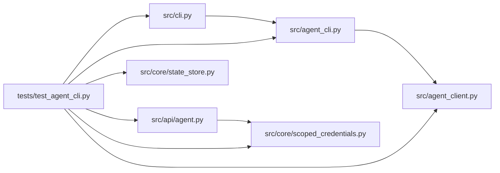

# test_agent_cli Module

**Path:** `tests/test_agent_cli.py`

## Description

Attached-agent CLI: schemas, exit codes, redaction, reconnect.

The workflow is proven from an external program (the shell example)
against a real server, and the installed-package smoke runs outside the
checkout. Credentials never appear in arguments or logs.

## Imports

| Source | Symbols |
|--------|---------|
| `__future__` | `annotations` |
| `argparse` | `argparse` |
| `asyncio` | `asyncio`, `asyncio` |
| `contextlib` | `contextlib` |
| `fastapi` | `FastAPI` |
| `httpx` | `httpx` |
| `io` | `io` |
| `json` | `json` |
| `os` | `os` |
| `pathlib` | `Path` |
| `pytest` | `pytest` |
| `socket` | `socket` |
| `src.agent_cli` | `EXIT_AUTH`, `EXIT_CODES`, `EXIT_CONFLICT`, `EXIT_LIMIT`, `EXIT_OK`, `EXIT_TIMEOUT`, `EXIT_TRANSPORT`, `EXIT_USAGE`, `SCHEMA_ERROR`, `SCHEMA_RESULT`, `set_transport`, `build_agent_parser` |
| `src.agent_client` | `AgentClient`, `redact` |
| `src.api.agent` | `init`, `router` |
| `src.cli` | `main` |
| `src.core.scoped_credentials` | `PERM_EVALUATE`, `PERM_LIFECYCLE`, `PERM_READ`, `PERM_SUBMIT`, `issue_scoped_credential` |
| `src.core.state_store` | `SQLiteStateStore` |
| `subprocess` | `subprocess` |
| `sys` | `sys` |
| `threading` | `threading` |
| `time` | `time` |
| `uvicorn` | `uvicorn` |
| `zipfile` | `zipfile` |

## Local dependency map

<!-- Auto-generated local dependency summary. Do not edit by hand. -->

### Internal neighbors

| Direction | Module |
|---|---|
| Outbound | [agent_cli](../modules/agent_cli.md) |
| Outbound | [agent_client](../modules/agent_client.md) |
| Outbound | [agent](../modules/agent.md) |
| Outbound | [cli](../modules/cli.md) |
| Outbound | [scoped_credentials](../modules/scoped_credentials.md) |
| Outbound | [state_store](../modules/state_store.md) |

### External packages

| Language | Used packages | Undeclared packages |
|---|---:|---:|
| python | 4 | 3 |

## Classes

| Class | Line | Bases | Description |
|-------|------|-------|-------------|
| [_Probe](../entities/Probe.md) | 60 | — | — |

## Functions

| Function | Signature | Decorators | Description |
|----------|-----------|------------|-------------|
| `_credential` | `()` | — | — |
| `_app_and_store` | `(tmp_path)` | — | — |
| `cli_env` | `(tmp_path, monkeypatch)` | `@pytest.fixture` | — |
| `_run_cli` | `(argv)` | — | — |
| `test_json_envelopes_and_schema_fields` | `(cli_env, tmp_path)` | — | — |
| `test_error_envelope_and_exit_codes` | `(cli_env, monkeypatch, tmp_path)` | — | — |
| `test_credentials_never_leak_in_arguments_or_logs` | `(cli_env, capsys)` | — | — |
| `test_event_cursor_persists_across_interruption` | `(cli_env, tmp_path)` | — | — |
| `test_bounded_wait_times_out` | `(cli_env)` | — | — |
| `test_external_driver_example_completes_workflow` | `(tmp_path)` | — | The shell driver knows only the CLI and its exit codes. |
| `test_installed_cli_smoke_outside_checkout` | `(tmp_path)` | — | Installed-layout smoke for the CLI (env-gated on release artifacts). |
