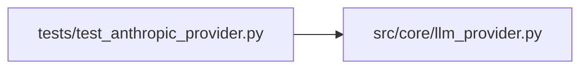

# test_anthropic_provider Module

**Path:** `tests/test_anthropic_provider.py`

## Description

Unit tests for ``AnthropicProvider`` — the SDK boundary translator
(ARC-011 P1-002).

The provider is a thin adapter: normalized ``Message``/``ToolDef``/``system``
→ Anthropic ``messages.create`` kwargs (byte-identical to the pre-refactor
orchestrator call), and raw ``anthropic.types.Message`` → normalized
``ProviderResponse``. These tests pin the translation + the R5 stop-reason
invariant + ``classify_error`` (which backs loop-owned retry), using a fake
``AsyncAnthropic`` whose ``messages.create`` returns a canned raw response.

## Imports

| Source | Symbols |
|--------|---------|
| `__future__` | `annotations` |
| `anthropic` | `anthropic`, `anthropic`, `anthropic` |
| `pytest` | `pytest` |
| `src.core.llm_provider` | `_CLAUDE_INPUT_USD_PER_TOKEN`, `_CLAUDE_OUTPUT_USD_PER_TOKEN`, `AnthropicProvider`, `ErrorClass`, `Message`, `StopReason`, `TextBlock`, `ToolDef`, `ToolResultBlock`, `ToolUseBlock`, `Usage`, `_to_sdk_messages`, `_to_sdk_tools` |
| `sys` | `sys` |
| `types` | `types`, `ModuleType` |
| `typing` | `Any`, `cast` |
| `unittest.mock` | `AsyncMock`, `MagicMock` |

## Local dependency map

<!-- Auto-generated local dependency summary. Do not edit by hand. -->

### Internal neighbors

| Direction | Module |
|---|---|
| Outbound | [llm_provider](../modules/llm_provider.md) |

### External packages

| Language | Used packages | Undeclared packages |
|---|---:|---:|
| python | 2 | 2 |

## Functions

| Function | Signature | Decorators | Description |
|----------|-----------|------------|-------------|
| `_raw_block` | `(block_type: str, **fields: Any) -> Any` | — | A fake SDK content block (attribute-access, like anthropic.types). |
| `_raw_response` | `(*, content: list[Any], stop_reason: str, model: str = 'claude-test', input_tokens: int = 10, output_tokens: int = 5) -> Any` | — | — |
| `_make_provider` | `() -> AnthropicProvider` | — | A provider whose client.messages.create is an AsyncMock to be configured. |
| `test_to_sdk_messages_str_content` | `()` | — | A plain-string user prompt maps to the Anthropic string-content shape. |
| `test_to_sdk_messages_mixed_blocks` | `()` | — | Assistant + tool-result turns map to lists of Anthropic block dicts. |
| `test_to_sdk_messages_tool_use_block` | `()` | — | A tool_use request block maps to the Anthropic tool_use dict shape. |
| `test_to_sdk_tools_matches_agent_tools_shape` | `()` | — | ToolDef maps to the {name, description, input_schema} dicts AGENT_TOOLS used. |
| `test_messages_create_maps_text_and_tool_use_blocks` | *(async)* `()` | `@pytest.mark.asyncio` | — |
| `test_messages_create_r5_invariant_tool_use_overrides_end_turn` | *(async)* `()` | `@pytest.mark.asyncio` | R5: a tool_use block forces StopReason.TOOL_USE even if native says end_turn. |
| `test_messages_create_stop_reason_mapping_without_tool_use` | *(async)* `()` | `@pytest.mark.asyncio` | — |
| `test_messages_create_unknown_stop_reason_maps_to_other` | *(async)* `()` | `@pytest.mark.asyncio` | — |
| `test_messages_create_omits_unset_temperature_and_stop_sequences` | *(async)* `()` | `@pytest.mark.asyncio` | The orchestrator never sets temperature/stop_sequences; the wire request |
| `test_complete_returns_joined_text` | *(async)* `()` | `@pytest.mark.asyncio` | — |
| `test_complete_passes_system_when_provided` | *(async)* `()` | `@pytest.mark.asyncio` | — |
| `_instance_without_init` | `(cls: type[Any], **attrs: Any) -> Any` | — | Construct an exception instance bypassing __init__ (sets attributes after). |
| `_status_error` | `(status_code: int) -> Exception` | — | — |
| `test_classify_error_transient_connection_exceptions` | `()` | — | APITimeout/APIConnection/InternalServer are transient (no status code). |
| `test_classify_error_transient_status_codes` | `()` | — | 429/502/503/529 are transient; other statuses are not. |
| `test_classify_error_non_transient_status_code` | `()` | — | — |
| `test_classify_error_non_anthropic_exception_is_not_transient` | `()` | — | — |
| `test_estimate_cost_flat_sonnet_baseline` | `()` | — | Cost = input*$3/M + output*$15/M (parity with pre-refactor accounting). |
