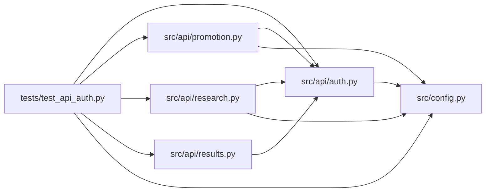

# test_api_auth Module

**Path:** `tests/test_api_auth.py`

## Description

_Auto-generated from `tests/test_api_auth.py`._

## Imports

| Source | Symbols |
|--------|---------|
| `__future__` | `annotations` |
| `base64` | `base64` |
| `fastapi` | `FastAPI`, `WebSocket`, `WebSocketDisconnect` |
| `fastapi.testclient` | `TestClient` |
| `logging` | `logging` |
| `os` | `os` |
| `pathlib` | `Path` |
| `pytest` | `pytest` |
| `src.api` | `auth`, `promotion`, `research`, `results` |
| `src.api.auth` | `require_websocket_auth` |
| `src.config` | `Settings`, `settings` |
| `starlette.testclient` | `WebSocketDenialResponse` |

## Local dependency map

<!-- Auto-generated local dependency summary. Do not edit by hand. -->

### Internal neighbors

| Direction | Module |
|---|---|
| Outbound | [auth](../modules/auth.md) |
| Outbound | [promotion](../modules/promotion.md) |
| Outbound | [research](../modules/research.md) |
| Outbound | [results](../modules/results.md) |
| Outbound | [config](../modules/config.md) |

### External packages

| Language | Used packages | Undeclared packages |
|---|---:|---:|
| python | 3 | 3 |

## Classes

| Class | Line | Bases | Description |
|-------|------|-------|-------------|
| [FakeSessionManager](../entities/test_api_auth_FakeSessionManager.md) | 55 | — | — |
| [FakeStore](../entities/test_api_auth_FakeStore.md) | 90 | — | — |
| [FakePromoter](../entities/test_api_auth_FakePromoter.md) | 215 | — | — |

## Functions

| Function | Signature | Decorators | Description |
|----------|-----------|------------|-------------|
| `create_test_app` | `() -> FastAPI` | — | — |
| `configure_api_auth` | `(monkeypatch)` | `@pytest.fixture(autouse=True)` | — |
| `client` | `() -> TestClient` | `@pytest.fixture` | — |
| `auth_headers` | `() -> dict[str, str]` | — | — |
| `start_payload` | `() -> dict[str, object]` | — | — |
| `test_health_is_public_but_api_routes_require_bearer_token` | `(client: TestClient)` | — | — |
| `test_authenticated_api_calls_preserve_existing_behavior` | `(client: TestClient)` | — | — |
| `test_api_v1_and_legacy_api_prefixes_are_both_protected` | `(client: TestClient)` | — | — |
| `test_continue_requires_and_replays_idempotency_key` | `(client: TestClient)` | — | — |
| `test_state_changing_research_requests_write_audit_events` | `(client: TestClient, configure_api_auth: FakeStore)` | — | — |
| `test_recent_audit_events_endpoint_returns_filtered_events` | `(client: TestClient, configure_api_auth: FakeStore)` | — | — |
| `test_promotion_and_rollback_failures_write_audit_events` | `(client: TestClient, configure_api_auth: FakeStore)` | — | — |
| `test_rejected_api_auth_records_audit_fingerprint_not_token` | `(client: TestClient, configure_api_auth: FakeStore)` | — | — |
| `test_rejected_api_auth_warns_when_audit_store_missing` | `(caplog)` | — | — |
| `test_identity_jwt_admin_token_is_accepted` | `(client: TestClient, configure_api_auth: FakeStore, monkeypatch)` | — | — |
| `test_identity_jwt_without_admin_role_is_rejected` | `(client: TestClient, configure_api_auth: FakeStore, monkeypatch)` | — | — |
| `test_websocket_requires_authentication` | `(client: TestClient)` | — | — |
| `test_websocket_accepts_authorization_header` | `(client: TestClient)` | — | — |
| `test_websocket_accepts_identity_jwt_header` | `(client: TestClient, monkeypatch)` | — | — |
| `test_websocket_accepts_browser_subprotocol_token` | `(client: TestClient)` | — | — |
| `test_default_cors_origins_are_local_not_wildcard` | `(monkeypatch)` | — | — |
| `test_settings_accept_canonical_autoresearch_aliases` | `(monkeypatch)` | — | — |
| `test_settings_keep_bare_env_fallbacks` | `(monkeypatch)` | — | — |
| `test_identity_introspection_defaults_to_disabled` | `(monkeypatch)` | — | — |
| `test_sensitive_settings_do_not_leak_in_repr` | `()` | — | — |
| `test_compose_binds_autoresearch_port_to_loopback_by_default` | `()` | — | — |
