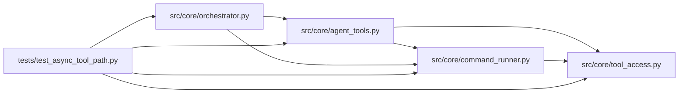

# test_async_tool_path Module

**Path:** `tests/test_async_tool_path.py`

## Description

Tests for the sync tool-dispatch path (ARC-011 P1-029 / P1-030).

History note: P1-029 originally proposed migrating ``grep`` from a synchronous
``subprocess.run`` (run inside ``asyncio.to_thread``) to
``asyncio.create_subprocess_exec``, and making ``_execute_tool`` itself
``async``. That migration was **reverted** in favor of the existing
``asyncio.to_thread`` wrapping (orchestrator.py:648) — keeping every tool call
site uniform. These tests pin the **current** sync contract:

* the dispatch shape (``_execute_tool`` / ``_tool_grep`` are sync functions;
  ``_tool_glob`` is sync pure-Python);
* the grep happy-path output + the 60k-char truncation + the no-match marker;
* the ``subprocess.run(timeout=30)`` path returns the timeout marker on
  timeout (the standard-library reaper handles child cleanup; there is no
  in-process reap to test);
* the P1-029 security delta: the grep child runs with ``_build_child_env()``,
  so server control-plane secrets are stripped (same P0-023 invariant, applied
  to the previously-ungoverned grep path).

The behavioral gate for the bash tool path stays in ``test_command_policy.py``;
this file covers the grep / glob tools specifically.

## Imports

| Source | Symbols |
|--------|---------|
| `__future__` | `annotations` |
| `inspect` | `inspect` |
| `json` | `json` |
| `os` | `os` |
| `pathlib` | `Path` |
| `pytest` | `pytest` |
| `src.core.agent_tools` | `tools`, `tools`, `tools` |
| `src.core.command_runner` | `_build_child_env` |
| `src.core.orchestrator` | `_execute_tool`, `_tool_glob`, `_tool_grep` |
| `src.core.tool_access` | `ToolAccessContext`, `build_tool_access_context` |
| `subprocess` | `subprocess` |
| `sys` | `sys` |
| `time` | `time` |

## Local dependency map

<!-- Auto-generated local dependency summary. Do not edit by hand. -->

### Internal neighbors

| Direction | Module |
|---|---|
| Outbound | [agent_tools](../modules/agent_tools.md) |
| Outbound | [command_runner](../modules/command_runner.md) |
| Outbound | [orchestrator](../modules/orchestrator.md) |
| Outbound | [tool_access](../modules/tool_access.md) |

### External packages

| Language | Used packages | Undeclared packages |
|---|---:|---:|
| python | 1 | 1 |

## Functions

| Function | Signature | Decorators | Description |
|----------|-----------|------------|-------------|
| `_workspace` | `(tmp_path: Path) -> str` | — | — |
| `_access` | `(workspace: str) -> ToolAccessContext` | — | — |
| `test_execute_tool_is_sync_function` | `()` | — | ``_execute_tool`` is a plain synchronous function. The agent loop wraps |
| `test_tool_grep_is_sync_function` | `()` | — | ``_tool_grep`` is a plain synchronous function (uses ``subprocess.run`` |
| `test_tool_glob_is_sync_function` | `()` | — | ``_tool_glob`` is synchronous (pure-Python, non-blocking). |
| `test_grep_returns_matches` | `(tmp_path: Path)` | — | ``grep`` finds the pattern across files and returns matching lines. |
| `test_grep_no_matches_returns_marker` | `(tmp_path: Path)` | — | No matches → the ``"(no matches)"`` sentinel. |
| `test_grep_truncates_large_output` | `(tmp_path: Path)` | — | Output > 60k chars is truncated to the 30k-head + 30k-tail shape. |
| `test_grep_include_filter` | `(tmp_path: Path)` | — | The ``--include`` glob narrows the search. |
| `test_execute_tool_dispatches_grep` | `(tmp_path: Path)` | — | ``_execute_tool("grep", ...)`` routes through ``_tool_grep`` and returns |
| `test_execute_tool_dispatches_glob` | `(tmp_path: Path)` | — | ``glob`` routes through ``_tool_glob`` via ``_execute_tool``. |
| `test_grep_timeout_returns_marker` | `(tmp_path: Path, monkeypatch)` | — | Exercise real deadline enforcement and process cleanup with a short budget. |
| `test_grep_does_not_inherit_control_plane_secrets` | `(tmp_path: Path, monkeypatch)` | — | P1-029 security delta: the grep child runs with ``_build_child_env()`` |
| `test_grep_child_env_still_has_path` | `(tmp_path: Path, monkeypatch)` | — | Companion to the secret-leak test: the scrubbed env must still carry |
