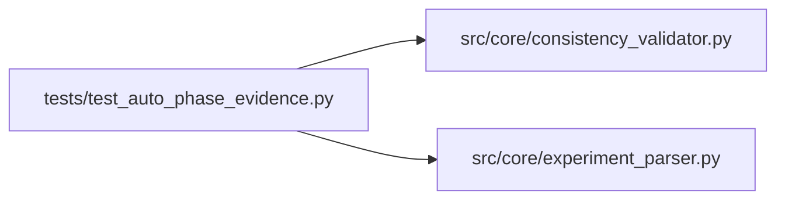

# test_auto_phase_evidence Module

**Path:** `tests/test_auto_phase_evidence.py`

## Description

Tests for auto_phase_evidence flag parsing and consistency_validator guard.

auto_phase_evidence=true is emitted by prepare.py alongside calibration/
inference evidence keys. It signals that the evidence was auto-generated by
the training pipeline (not assembled by the agent as a real promotion candidate).
The consistency_validator must NOT trigger hard checks for such iterations.

## Imports

| Source | Symbols |
|--------|---------|
| `__future__` | `annotations` |
| `pytest` | `pytest` |
| `src.core.consistency_validator` | `build_consistency_report` |
| `src.core.experiment_parser` | `parse_prepare_output` |

## Local dependency map

<!-- Auto-generated local dependency summary. Do not edit by hand. -->

### Internal neighbors

| Direction | Module |
|---|---|
| Outbound | [consistency_validator](../modules/consistency_validator.md) |
| Outbound | [experiment_parser](../modules/experiment_parser.md) |

### External packages

| Language | Used packages | Undeclared packages |
|---|---:|---:|
| python | 1 | 1 |

## Classes

| Class | Line | Bases | Description |
|-------|------|-------|-------------|
| [TestAutoPhaseEvidenceParsing](../entities/TestAutoPhaseEvidenceParsing.md) | 33 | — | — |
| [TestAutoPhaseEvidenceConsistencyGuard](../entities/TestAutoPhaseEvidenceConsistencyGuard.md) | 78 | — | — |

## Functions

| Function | Signature | Decorators | Description |
|----------|-----------|------------|-------------|
| `_block` | `(extra: str = '') -> str` | — | — |
| `_late_phase_metrics` | `(auto: bool \| None = None) -> dict` | — | Metrics that include calibration/inference evidence, mimicking auto-emitted data. |
