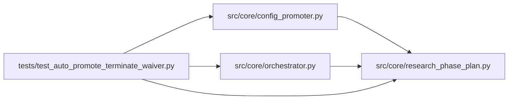

# test_auto_promote_terminate_waiver Module

**Path:** `tests/test_auto_promote_terminate_waiver.py`

## Description

Tests for the TERMINATE_REQUEST promotion waiver.

When the agent emits an explicit `TERMINATE_REQUEST:` line, the orchestrator
sets `terminate_request_received=True` on the session. `_try_auto_promote`
treats that as a "the agent concluded baseline is best" signal and waives
incomplete iteration-count phases for promotion — hard gates (training,
calibration, parity) still run via `promoter.preview()`.

Silent end_turn / crash / timeout sessions do NOT get this waiver and still
block promotion when phases are incomplete.

## Imports

| Source | Symbols |
|--------|---------|
| `__future__` | `annotations` |
| `anthropic` | `anthropic` |
| `json` | `json` |
| `pytest` | `pytest` |
| `src.core` | `config_promoter`, `orchestrator` |
| `src.core.orchestrator` | `AgentOrchestrator`, `ResearchConfig` |
| `src.core.research_phase_plan` | `phases_for_model` |
| `sys` | `sys` |
| `types` | `types` |
| `typing` | `Any`, `Dict`, `List`, `Optional` |

## Local dependency map

<!-- Auto-generated local dependency summary. Do not edit by hand. -->

### Internal neighbors

| Direction | Module |
|---|---|
| Outbound | [config_promoter](../modules/config_promoter.md) |
| Outbound | [orchestrator](../modules/orchestrator.md) |
| Outbound | [research_phase_plan](../modules/research_phase_plan.md) |

### External packages

| Language | Used packages | Undeclared packages |
|---|---:|---:|
| python | 2 | 2 |

## Classes

| Class | Line | Bases | Description |
|-------|------|-------|-------------|
| [FakeAgentLog](../entities/test_auto_promote_terminate_waiver_FakeAgentLog.md) | 39 | — | — |
| [FakeBroadcaster](../entities/test_auto_promote_terminate_waiver_FakeBroadcaster.md) | 47 | — | — |
| [FakeStore](../entities/test_auto_promote_terminate_waiver_FakeStore.md) | 55 | — | — |

## Functions

| Function | Signature | Decorators | Description |
|----------|-----------|------------|-------------|
| `_config` | `() -> ResearchConfig` | — | — |
| `_phase_state` | `(status_by_phase: Dict[str, str]) -> Dict[str, Any]` | — | — |
| `_baseline_complete_tabular_incomplete` | `() -> Dict[str, Any]` | — | Baseline done, agent gave up after exploring 5 tabular sweeps (needs 6+). |
| `_baseline_incomplete` | `() -> Dict[str, Any]` | — | Crash mid-baseline — nothing legitimately validated. |
| `_install_promoter` | `(monkeypatch: pytest.MonkeyPatch, *, preview_payload: Optional[Dict[str, Any]] = None) -> Dict[str, List[str]]` | — | — |
| `_install_broadcaster` | `(monkeypatch: pytest.MonkeyPatch) -> FakeBroadcaster` | — | — |
| `test_terminate_request_waives_incomplete_phases_with_baseline_complete` | *(async)* `(monkeypatch: pytest.MonkeyPatch) -> None` | `@pytest.mark.asyncio` | Agent explicitly TERMINATE_REQUESTed; baseline complete; tabular_sweeps short. |
| `test_terminate_request_still_blocks_when_baseline_incomplete` | *(async)* `(monkeypatch: pytest.MonkeyPatch) -> None` | `@pytest.mark.asyncio` | TERMINATE_REQUEST without baseline_capture complete should NOT waive. |
| `test_silent_end_turn_still_blocks` | *(async)* `(monkeypatch: pytest.MonkeyPatch) -> None` | `@pytest.mark.asyncio` | Without explicit TERMINATE_REQUEST, incomplete phases block (existing behavior). |
