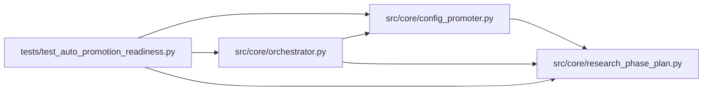

# test_auto_promotion_readiness Module

**Path:** `tests/test_auto_promotion_readiness.py`

## Description

_Auto-generated from `tests/test_auto_promotion_readiness.py`._

## Imports

| Source | Symbols |
|--------|---------|
| `__future__` | `annotations` |
| `anthropic` | `anthropic` |
| `json` | `json` |
| `pytest` | `pytest` |
| `src.core` | `config_promoter`, `orchestrator` |
| `src.core.orchestrator` | `AgentOrchestrator`, `ResearchConfig` |
| `src.core.research_phase_plan` | `phases_for_model` |
| `sys` | `sys` |
| `types` | `types`, `ModuleType` |
| `typing` | `Any`, `Dict`, `List`, `Optional`, `cast` |

## Local dependency map

<!-- Auto-generated local dependency summary. Do not edit by hand. -->

### Internal neighbors

| Direction | Module |
|---|---|
| Outbound | [config_promoter](../modules/config_promoter.md) |
| Outbound | [orchestrator](../modules/orchestrator.md) |
| Outbound | [research_phase_plan](../modules/research_phase_plan.md) |

### External packages

| Language | Used packages | Undeclared packages |
|---|---:|---:|
| python | 2 | 2 |

## Classes

| Class | Line | Bases | Description |
|-------|------|-------|-------------|
| [FakeAgentLog](../entities/test_auto_promotion_readiness_FakeAgentLog.md) | 28 | — | — |
| [FakeBroadcaster](../entities/test_auto_promotion_readiness_FakeBroadcaster.md) | 36 | — | — |
| [FakeStore](../entities/test_auto_promotion_readiness_FakeStore.md) | 44 | — | — |

## Functions

| Function | Signature | Decorators | Description |
|----------|-----------|------------|-------------|
| `_config` | `() -> ResearchConfig` | — | — |
| `_phase_state` | `(status_by_phase: Dict[str, str]) -> Dict[str, Any]` | — | — |
| `_complete_until_promotion_state` | `() -> Dict[str, Any]` | — | — |
| `_incomplete_adaptive_state` | `() -> Dict[str, Any]` | — | — |
| `_install_promoter` | `(monkeypatch: pytest.MonkeyPatch, *, preview_payload: Optional[Dict[str, Any]] = None, preview_exc: Optional[Exception] = None) -> Dict[str, List[str]]` | — | — |
| `_install_broadcaster` | `(monkeypatch: pytest.MonkeyPatch) -> FakeBroadcaster` | — | — |
| `test_auto_promote_skips_when_pre_promotion_phases_incomplete` | *(async)* `(monkeypatch: pytest.MonkeyPatch) -> None` | `@pytest.mark.asyncio` | — |
| `test_auto_promote_uses_preview_before_confirm` | *(async)* `(monkeypatch: pytest.MonkeyPatch) -> None` | `@pytest.mark.asyncio` | — |
| `test_auto_promote_reports_quality_baseline_blocker` | *(async)* `(monkeypatch: pytest.MonkeyPatch) -> None` | `@pytest.mark.asyncio` | — |
| `test_auto_promote_uses_training_gate_alias_before_preview` | *(async)* `(monkeypatch: pytest.MonkeyPatch) -> None` | `@pytest.mark.asyncio` | — |
| `test_auto_promote_confirms_only_when_preview_allowed` | *(async)* `(monkeypatch: pytest.MonkeyPatch) -> None` | `@pytest.mark.asyncio` | — |
| `test_auto_promote_treats_preview_value_error_as_skip` | *(async)* `(monkeypatch: pytest.MonkeyPatch, caplog: pytest.LogCaptureFixture) -> None` | `@pytest.mark.asyncio` | — |
