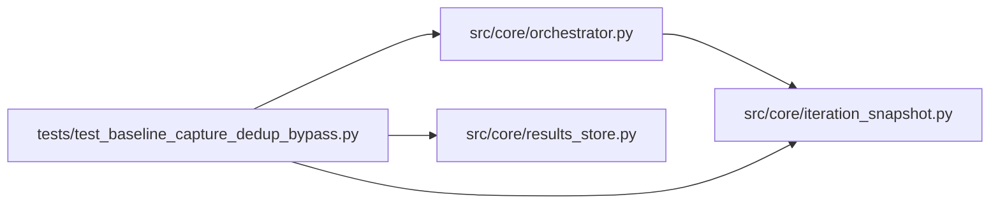

# test_baseline_capture_dedup_bypass Module

**Path:** `tests/test_baseline_capture_dedup_bypass.py`

## Description

Tests for the baseline_capture cross-session dedup bypass.

When the agent is in `baseline_capture` phase and submits a config whose
canonical_config_hash matches a prior session's recorded baseline (the
expected case, since the phase contract says "run the immutable baseline"),
the orchestrator should INHERIT the prior metric instead of rejecting the
attempt. Same-session duplicates remain rejected.

## Imports

| Source | Symbols |
|--------|---------|
| `__future__` | `annotations` |
| `anthropic` | `anthropic` |
| `json` | `json`, `_json`, `json` |
| `logging` | `logging` |
| `os` | `os` |
| `pathlib` | `Path` |
| `pytest` | `pytest` |
| `src.core.iteration_snapshot` | `build_trial_identity`, `trial_identity_hash`, `build_trial_identity`, `trial_identity_hash`, `build_trial_identity`, `trial_identity_hash` |
| `src.core.orchestrator` | `AgentOrchestrator`, `ResearchConfig` |
| `src.core.results_store` | `ResultsStore` |
| `sys` | `sys` |
| `types` | `types`, `ModuleType` |
| `typing` | `cast` |

## Local dependency map

<!-- Auto-generated local dependency summary. Do not edit by hand. -->

### Internal neighbors

| Direction | Module |
|---|---|
| Outbound | [iteration_snapshot](../modules/iteration_snapshot.md) |
| Outbound | [orchestrator](../modules/orchestrator.md) |
| Outbound | [results_store](../modules/results_store.md) |

### External packages

| Language | Used packages | Undeclared packages |
|---|---:|---:|
| python | 2 | 2 |

## Functions

| Function | Signature | Decorators | Description |
|----------|-----------|------------|-------------|
| `_seed_prior_baseline` | *(async)* `(store: ResultsStore, *, workspace: Path, metric: float = 0.6435) -> str` | — | Create a prior session with one recorded baseline iteration. |
| `test_baseline_capture_inherits_cross_session_baseline` | *(async)* `(tmp_path: Path) -> None` | `@pytest.mark.asyncio` | When phase=baseline_capture and a prior session has the same config, |
| `test_baseline_link_inherits_passed_gates_from_prior_metrics_json` | *(async)* `(tmp_path: Path, caplog: pytest.LogCaptureFixture) -> None` | `@pytest.mark.asyncio` | Fix A regression: training_gates_passed lives in metrics_json, not as |
| `test_baseline_link_inherits_failed_gates` | *(async)* `(tmp_path: Path) -> None` | `@pytest.mark.asyncio` | Fix A: when the prior baseline genuinely failed, both flags propagate |
| `test_baseline_capture_same_session_duplicate_still_rejected` | *(async)* `(tmp_path: Path) -> None` | `@pytest.mark.asyncio` | A duplicate within the same session is still rejected even in |
| `test_baseline_capture_no_prior_returns_none` | *(async)* `(tmp_path: Path) -> None` | `@pytest.mark.asyncio` | First-ever baseline (no prior session) is not flagged at all. |
| `test_non_baseline_phase_still_rejects_cross_session` | *(async)* `(tmp_path: Path) -> None` | `@pytest.mark.asyncio` | Cross-session duplicates outside baseline_capture remain rejected. |
