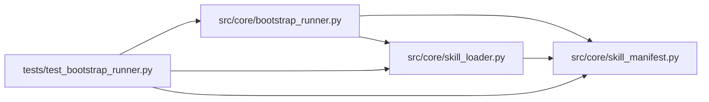

# test_bootstrap_runner Module

**Path:** `tests/test_bootstrap_runner.py`

## Description

BootstrapRunner tests (ARC-011 P5-005 / P5-006 / P5-008 / P5-009).

Covers:

* **P5-005** — the runner delegates to ``PluginRunner`` (env/path/fail-closed
  guarantees are tested in ``test_plugin_runner.py``; here we pin the
  bootstrap-specific wiring).
* **P5-006** — the ``session_bootstrap.v1`` artifact writer (shape, atomicity,
  round-trip, rendered-file hashing).
* **P5-008** — ``--dry-bootstrap`` overlay mode (no writes to the real ws;
  artifact carries ``mode: dry``).
* **P5-009** — idempotency (re-bootstrap is a no-op when hashes match), and
  the failure paths (missing bootstrap plugin, plugin failure).

## Imports

| Source | Symbols |
|--------|---------|
| `__future__` | `annotations` |
| `asyncio` | `asyncio` |
| `json` | `json` |
| `pathlib` | `Path` |
| `pytest` | `pytest` |
| `src.core.bootstrap_runner` | `BOOTSTRAP_ARTIFACT_FILENAME`, `BOOTSTRAP_ARTIFACT_VERSION`, `BootstrapRunner`, `SessionBootstrapArtifact` |
| `src.core.skill_loader` | `load_layout` |
| `src.core.skill_manifest` | `SCHEMA_VERSION`, `ResearchSkillManifest` |
| `textwrap` | `textwrap` |
| `typing` | `Any` |

## Local dependency map

<!-- Auto-generated local dependency summary. Do not edit by hand. -->

### Internal neighbors

| Direction | Module |
|---|---|
| Outbound | [bootstrap_runner](../modules/bootstrap_runner.md) |
| Outbound | [skill_loader](../modules/skill_loader.md) |
| Outbound | [skill_manifest](../modules/skill_manifest.md) |

### External packages

| Language | Used packages | Undeclared packages |
|---|---:|---:|
| python | 1 | 1 |

## Classes

| Class | Line | Bases | Description |
|-------|------|-------|-------------|
| [TestBootstrapArtifact](../entities/TestBootstrapArtifact.md) | 96 | — | — |
| [TestBootstrapRunnerLive](../entities/TestBootstrapRunnerLive.md) | 131 | — | — |
| [TestBootstrapRunnerDry](../entities/TestBootstrapRunnerDry.md) | 210 | — | — |
| [TestBootstrapIdempotency](../entities/TestBootstrapIdempotency.md) | 274 | — | — |

## Functions

| Function | Signature | Decorators | Description |
|----------|-----------|------------|-------------|
| `_manifest_dict` | `(**overrides: Any) -> dict[str, Any]` | — | — |
| `skill_with_bootstrap` | `(tmp_path: Path) -> tuple[Path, ResearchSkillManifest]` | `@pytest.fixture()` | A skill package with a working ``bootstrap.py`` that renders two files. |
