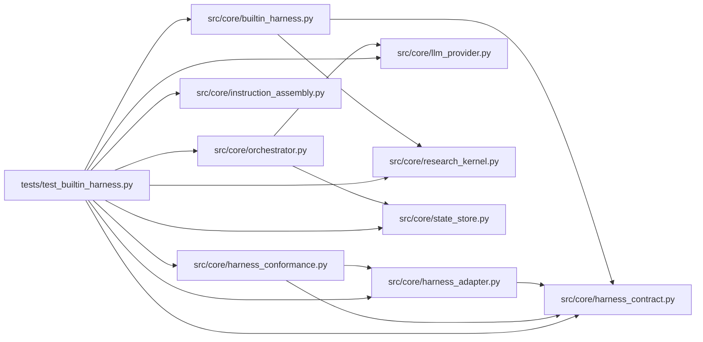

# test_builtin_harness Module

**Path:** `tests/test_builtin_harness.py`

## Description

The built-in harness adapter: conformance, kernel routing, instructions,
cleanup, and provider parity.

The rendered prompts here are product assets under test; they do not
control the implementation agent's repository workflow.

## Imports

| Source | Symbols |
|--------|---------|
| `__future__` | `annotations` |
| `pytest` | `pytest` |
| `src.core` | `orchestrator` |
| `src.core.builtin_harness` | `BUILTIN_WORKSPACE_INSTRUCTION_FILE`, `BuiltinHarnessAdapter` |
| `src.core.harness_adapter` | `HarnessRegistry` |
| `src.core.harness_conformance` | `run_conformance` |
| `src.core.harness_contract` | `ATTACH_MODE_CONTINUATION`, `ATTACH_MODE_NATIVE_RESUME`, `CAPABILITY_PAUSE`, `CAPABILITY_RESUME`, `HarnessContractError` |
| `src.core.instruction_assembly` | `COMMON_RESEARCH_INSTRUCTIONS`, `assemble_instructions`, `harness_tool_instructions`, `render_workspace_instructions` |
| `src.core.llm_provider` | `MockProvider`, `Usage` |
| `src.core.orchestrator` | `AgentOrchestrator`, `AgentOrchestrator` |
| `src.core.research_kernel` | `run_kernel_lifecycle` |
| `src.core.state_store` | `SQLiteStateStore` |

## Local dependency map

<!-- Auto-generated local dependency summary. Do not edit by hand. -->

### Internal neighbors

| Direction | Module |
|---|---|
| Outbound | [builtin_harness](../modules/builtin_harness.md) |
| Outbound | [harness_adapter](../modules/harness_adapter.md) |
| Outbound | [harness_conformance](../modules/harness_conformance.md) |
| Outbound | [harness_contract](../modules/harness_contract.md) |
| Outbound | [instruction_assembly](../modules/instruction_assembly.md) |
| Outbound | [llm_provider](../modules/llm_provider.md) |
| Outbound | [orchestrator](../modules/orchestrator.md) |
| Outbound | [research_kernel](../modules/research_kernel.md) |
| Outbound | [state_store](../modules/state_store.md) |

### External packages

| Language | Used packages | Undeclared packages |
|---|---:|---:|
| python | 1 | 1 |

## Classes

| Class | Line | Bases | Description |
|-------|------|-------|-------------|
| [_ClosableProvider](../entities/ClosableProvider.md) | 173 | — | — |

## Functions

| Function | Signature | Decorators | Description |
|----------|-----------|------------|-------------|
| `_scripted_attempt_fn` | `()` | — | — |
| `test_builtin_adapter_conforms_to_the_harness_contract` | `()` | — | — |
| `test_builtin_adapter_is_selected_explicitly_from_the_registry` | `()` | — | — |
| `test_builtin_adapter_completes_the_kernel_lifecycle` | `()` | — | — |
| `test_builtin_proposals_route_through_the_kernel` | `()` | — | — |
| `test_attach_holds_the_honest_mode` | `()` | — | — |
| `test_instruction_snapshot_common_and_harness_are_separate` | `()` | — | — |
| `test_workspace_instruction_file_is_rendered_through_the_adapter` | `()` | — | — |
| `test_core_reads_whatever_instruction_file_the_adapter_names` | `(tmp_path, monkeypatch)` | — | — |
| `test_repeated_session_release_closes_per_session_state` | `(tmp_path)` | — | — |
| `test_adapter_behavior_is_provider_parity` | `()` | — | — |
