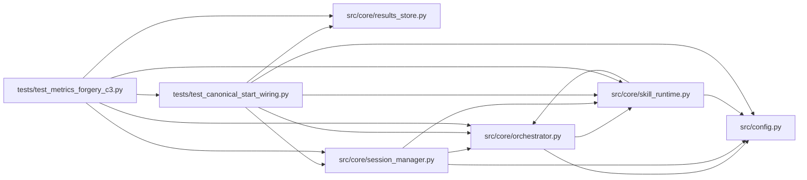

# test_canonical_start_wiring Module

**Path:** `tests/test_canonical_start_wiring.py`

## Description

ARC-011 implementation review C1 (2026-08-15) — canonical start wiring.

The review found that ``_translate_canonical_request`` validates the canonical
shape (``skill_id`` / ``skill_params`` / ``subject_id`` / ``variant``) but the
API then called ``start_session`` with only the legacy fields, so:

* canonical HPO params (``skill_params={"enable_hpo": true, ...}``) were
  silently ignored (``enable_hpo=False, hpo_trials=20`` defaults won), and
* ``ResearchConfig.skill_id`` was never set, so ``materialize_skill_runtime``
  always fell back to the transitional runtime.

These tests drive the **real** ``SessionManager`` (fake orchestrator + healthy
preflight, same pattern as ``test_service_preflight.py``'s session-start test)
and assert the canonical fields reach ``ResearchConfig`` and the built HPO
plan.

## Imports

| Source | Symbols |
|--------|---------|
| `__future__` | `annotations` |
| `anthropic` | `anthropic` |
| `asyncio` | `asyncio` |
| `os` | `os` |
| `pathlib` | `Path` |
| `pytest` | `pytest` |
| `src.config` | `settings` |
| `src.core.orchestrator` | `ResearchConfig` |
| `src.core.results_store` | `ResultsStore` |
| `src.core.session_manager` | `session_manager_module` |
| `src.core.skill_runtime` | `SkillConfigError` |
| `sys` | `sys` |
| `types` | `types`, `ModuleType` |
| `typing` | `Any`, `Dict`, `cast` |

## Local dependency map

<!-- Auto-generated local dependency summary. Do not edit by hand. -->

### Internal neighbors

| Direction | Module |
|---|---|
| Inbound | [test_metrics_forgery_c3](../modules/test_metrics_forgery_c3.md) |
| Outbound | [config](../modules/config.md) |
| Outbound | [orchestrator](../modules/orchestrator.md) |
| Outbound | [results_store](../modules/results_store.md) |
| Outbound | [session_manager](../modules/session_manager.md) |
| Outbound | [skill_runtime](../modules/skill_runtime.md) |

### External packages

| Language | Used packages | Undeclared packages |
|---|---:|---:|
| python | 2 | 2 |

## Classes

| Class | Line | Bases | Description |
|-------|------|-------|-------------|
| [_FakeAsyncAnthropic](../entities/test_canonical_start_wiring_FakeAsyncAnthropic.md) | 32 | — | — |
| [_FakeAPIStatusError](../entities/test_canonical_start_wiring_FakeAPIStatusError.md) | 36 | `Exception` | — |
| [FakeOrchestrator](../entities/FakeOrchestrator.md) | 56 | — | Captures the ResearchConfig the session manager hands to run(). |

## Functions

| Function | Signature | Decorators | Description |
|----------|-----------|------------|-------------|
| `_healthy_preflight` | *(async)* `(*, targets = None) -> Dict[str, Any]` | — | — |
| `_configure` | `(monkeypatch: pytest.MonkeyPatch, tmp_path: Path) -> None` | — | — |
| `_eval_set` | `(tmp_path: Path) -> str` | — | A real eval set for prompt-engineering starts (P7-011: the skill's |
| `_start_and_capture` | *(async)* `(monkeypatch: pytest.MonkeyPatch, tmp_path: Path, **start_kwargs: Any) -> tuple[Dict[str, Any], FakeOrchestrator]` | — | — |
| `test_canonical_fields_reach_research_config` | *(async)* `(monkeypatch, tmp_path)` | — | Canonical skill_params reach ResearchConfig verbatim. |
| `test_skill_params_win_over_legacy_flat_fields` | *(async)* `(monkeypatch, tmp_path)` | — | Canonical skill_params reach the config unchanged (no flat-field |
| `test_legacy_start_without_skill_id_is_refused` | *(async)* `(monkeypatch, tmp_path)` | — | ARC-012 P7-010 (B2): a legacy-shape start (``model_type`` only, no |
