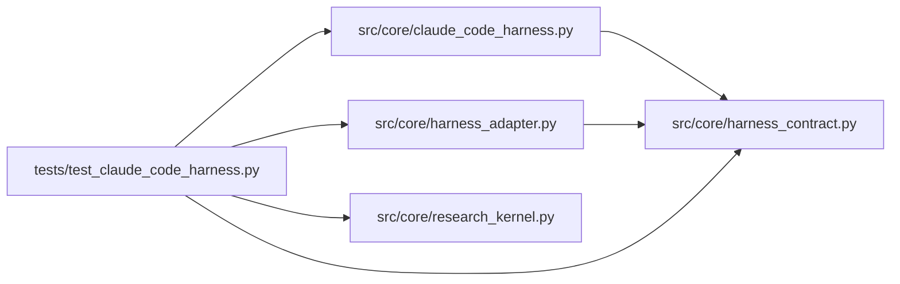

# test_claude_code_harness Module

**Path:** `tests/test_claude_code_harness.py`

## Description

Claude Code harness adapter: protocol fixtures and common contracts.

The recorded stream-json transcripts are the conformance fixtures: they
pin the documented event shapes (system/init, assistant content blocks,
result with usage/denials/session) and the mapping into the common
contracts. The live smoke is bounded and opt-in.

## Imports

| Source | Symbols |
|--------|---------|
| `__future__` | `annotations` |
| `json` | `json` |
| `os` | `os` |
| `pathlib` | `Path` |
| `pytest` | `pytest` |
| `shutil` | `shutil` |
| `src.core.claude_code_harness` | `CLAUDE_INTERFACE`, `CLAUDE_SCHEMA_PIN`, `UNSUPPORTED_OPTIONAL_FEATURES`, `ClaudeCodeHarnessAdapter`, `ClaudeRunConfig`, `map_candidate_changes`, `map_usage`, `normalize_claude_event` |
| `src.core.harness_adapter` | `request_pause`, `request_steer` |
| `src.core.harness_contract` | `ATTACH_MODE_CONTINUATION`, `ATTACH_MODE_NATIVE_RESUME`, `CAPABILITY_RESUME`, `HarnessContractError`, `HarnessLifecycleError`, `UnsupportedCapabilityError` |
| `src.core.research_kernel` | `AttemptResult`, `run_kernel_lifecycle` |
| `sys` | `sys` |
| `time` | `time` |

## Local dependency map

<!-- Auto-generated local dependency summary. Do not edit by hand. -->

### Internal neighbors

| Direction | Module |
|---|---|
| Outbound | [claude_code_harness](../modules/claude_code_harness.md) |
| Outbound | [harness_adapter](../modules/harness_adapter.md) |
| Outbound | [harness_contract](../modules/harness_contract.md) |
| Outbound | [research_kernel](../modules/research_kernel.md) |

### External packages

| Language | Used packages | Undeclared packages |
|---|---:|---:|
| python | 1 | 1 |

## Functions

| Function | Signature | Decorators | Description |
|----------|-----------|------------|-------------|
| `_fake_claude_script` | `(tmp_path, events)` | — | A stub 'claude' that replays the recorded fixture on stdout. |
| `_run_fixture` | `(tmp_path, events = None)` | — | — |
| `test_recorded_fixture_maps_into_common_contracts` | `(tmp_path)` | — | — |
| `test_tool_denial_is_failure_never_success` | `(tmp_path)` | — | — |
| `test_unknown_events_are_tolerated` | `()` | — | — |
| `test_capability_profile_is_qualified` | `(tmp_path)` | — | — |
| `test_native_resume_requires_a_recorded_session` | `(tmp_path)` | — | — |
| `test_attach_is_honest_about_native_resume` | `(tmp_path)` | — | — |
| `test_interruption_cleans_up_child_processes` | `(tmp_path)` | — | — |
| `test_adapter_executes_kernel_lifecycle` | `(tmp_path)` | — | — |
| `test_live_smoke_is_bounded_and_opt_in` | `(tmp_path)` | — | Opt-in live smoke: denial, interruption, resume, cleanup. |
