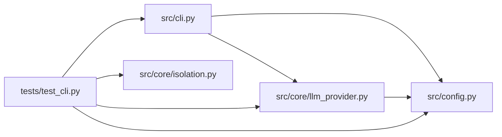

# test_cli Module

**Path:** `tests/test_cli.py`

## Description

CLI tests for the P2 Skill SDK (``autoresearch new-skill`` / ``promote-skill``).

Drives the real ``src.cli.main`` argument path with a stub LLM provider
(same contract as ``tests/test_skill_generator.py``): the generator,
validator, plugin caps, and promotion target all run for real — only the
LLM call is scripted.

## Imports

| Source | Symbols |
|--------|---------|
| `__future__` | `annotations` |
| `json` | `json` |
| `os` | `os` |
| `pathlib` | `Path` |
| `pytest` | `pytest` |
| `src` | `cli` |
| `src.config` | `get_settings`, `settings` |
| `src.core` | `llm_provider` |
| `src.core.isolation` | `probe_host` |
| `sys` | `sys` |
| `typing` | `Any` |
| `yaml` | `yaml` |

## Local dependency map

<!-- Auto-generated local dependency summary. Do not edit by hand. -->

### Internal neighbors

| Direction | Module |
|---|---|
| Outbound | [cli](../modules/cli.md) |
| Outbound | [config](../modules/config.md) |
| Outbound | [isolation](../modules/isolation.md) |
| Outbound | [llm_provider](../modules/llm_provider.md) |

### External packages

| Language | Used packages | Undeclared packages |
|---|---:|---:|
| python | 2 | 1 |

## Classes

| Class | Line | Bases | Description |
|-------|------|-------|-------------|
| [_StubProvider](../entities/test_cli_StubProvider.md) | 74 | — | Deterministic LLMProvider.complete stand-in. |

## Functions

| Function | Signature | Decorators | Description |
|----------|-----------|------------|-------------|
| `_valid_payload` | `(*, skill_id: str = 'cli-test-skill', policy: dict[str, Any] \| None = None) -> dict[str, Any]` | — | — |
| `skills_root` | `(tmp_path: Path) -> Path` | `@pytest.fixture` | — |
| `_run_cli` | `(argv: list[str], payload: dict[str, Any], monkeypatch) -> int` | — | — |
| `_last_lines` | `(capsys, n: int = 3) -> str` | — | — |
| `test_new_skill_writes_draft_under_skills_root` | `(monkeypatch, tmp_path, skills_root, capsys)` | — | — |
| `test_new_skill_dry_run_writes_nothing` | `(monkeypatch, tmp_path, skills_root, capsys)` | — | — |
| `test_new_skill_dry_bootstrap_previews_rendered_tree` | `(monkeypatch, tmp_path, skills_root, capsys)` | — | — |
| `test_new_skill_invalid_llm_output_blocks_without_writing` | `(monkeypatch, tmp_path, skills_root, capsys)` | — | — |
| `test_new_skill_openai_without_model_errors` | `(monkeypatch, skills_root, capsys)` | — | — |
| `test_promote_skill_moves_draft_to_stable` | `(monkeypatch, tmp_path, skills_root, capsys)` | — | — |
| `test_promote_skill_blocks_on_critical_findings` | `(monkeypatch, tmp_path, skills_root, capsys)` | — | — |
| `test_promote_skill_allow_critical_overrides` | `(monkeypatch, tmp_path, skills_root, capsys)` | — | — |
| `test_promote_skill_missing_draft_errors` | `(skills_root, capsys)` | — | — |
| `test_promote_tag_skips_gracefully_outside_git` | `(monkeypatch, tmp_path, skills_root, capsys)` | — | — |
| `test_promote_declines_without_confirmation` | `(monkeypatch, tmp_path, skills_root, capsys)` | — | — |
| `test_new_skill_inline_promote` | `(monkeypatch, tmp_path, skills_root, capsys)` | — | — |
