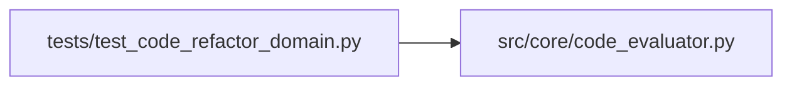

# test_code_refactor_domain Module

**Path:** `tests/test_code_refactor_domain.py`

## Description

The code-refactor domain: real test/lint/type evidence over bundles.

Verification covers valid and invalid refactor fixtures, test deletion
and skip attempts, timeouts, dependency failures, and artifact-bound
promotion previews. Performance claims exist only with a controlled
benchmark; a required-but-unmeasured gate is rejected.

## Imports

| Source | Symbols |
|--------|---------|
| `__future__` | `annotations` |
| `pathlib` | `Path` |
| `pytest` | `pytest` |
| `src.core.code_evaluator` | `CandidateBundle`, `EvalRequirements`, `apply_bundle`, `evaluate_bundle`, `is_protected`, `promotion_preview` |

## Local dependency map

<!-- Auto-generated local dependency summary. Do not edit by hand. -->

### Internal neighbors

| Direction | Module |
|---|---|
| Outbound | [code_evaluator](../modules/code_evaluator.md) |

### External packages

| Language | Used packages | Undeclared packages |
|---|---:|---:|
| python | 1 | 1 |

## Functions

| Function | Signature | Decorators | Description |
|----------|-----------|------------|-------------|
| `_bundle` | `(candidate_id, files)` | — | — |
| `test_valid_multifile_refactor_passes_all_gates` | `(tmp_path)` | — | — |
| `test_semantics_breaking_refactor_fails_even_with_expected_text` | `(tmp_path)` | — | — |
| `test_editing_test_files_cannot_improve_the_result` | `(tmp_path)` | — | — |
| `test_skip_injection_is_reverted_not_counted_as_pass` | `(tmp_path)` | — | — |
| `test_timeout_is_bounded_and_attributed` | `(tmp_path)` | — | — |
| `test_dependency_failure_is_reported` | `(tmp_path)` | — | — |
| `test_performance_gate_requires_a_controlled_benchmark` | `(tmp_path)` | — | — |
| `test_promotion_preview_is_bound_to_the_artifact` | `(tmp_path)` | — | — |
| `test_protected_paths_and_unsafe_targets` | `()` | — | — |
