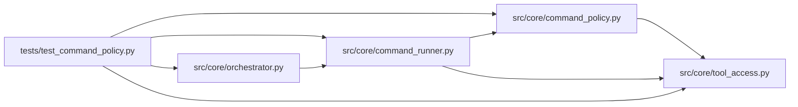

# test_command_policy Module

**Path:** `tests/test_command_policy.py`

## Description

_Auto-generated from `tests/test_command_policy.py`._

## Imports

| Source | Symbols |
|--------|---------|
| `__future__` | `annotations` |
| `anthropic` | `anthropic` |
| `hashlib` | `hashlib` |
| `json` | `json` |
| `os` | `os` |
| `pathlib` | `Path` |
| `pytest` | `pytest` |
| `src.core.command_policy` | `evaluate_command_policy` |
| `src.core.command_runner` | `_CHILD_ENV_ALLOWLIST`, `GovernedCommandRunner`, `redact_sensitive_text` |
| `src.core.orchestrator` | `_execute_tool` |
| `src.core.tool_access` | `build_tool_access_context` |
| `sys` | `sys` |
| `time` | `time` |
| `types` | `types` |

## Local dependency map

<!-- Auto-generated local dependency summary. Do not edit by hand. -->

### Internal neighbors

| Direction | Module |
|---|---|
| Outbound | [command_policy](../modules/command_policy.md) |
| Outbound | [command_runner](../modules/command_runner.md) |
| Outbound | [orchestrator](../modules/orchestrator.md) |
| Outbound | [tool_access](../modules/tool_access.md) |

### External packages

| Language | Used packages | Undeclared packages |
|---|---:|---:|
| python | 2 | 2 |

## Classes

| Class | Line | Bases | Description |
|-------|------|-------|-------------|
| [_FakeAsyncAnthropic](../entities/test_command_policy_FakeAsyncAnthropic.md) | 23 | — | — |
| [_FakeAPIStatusError](../entities/test_command_policy_FakeAPIStatusError.md) | 27 | `Exception` | — |

## Functions

| Function | Signature | Decorators | Description |
|----------|-----------|------------|-------------|
| `_workspace` | `(tmp_path: Path) -> tuple[str, str]` | — | — |
| `_pin_script` | `(tmp_path: Path, script_name: str, content: str) -> dict` | — | Create a digest-pinned packaged script outside the workspace. |
| `test_base_policy_is_default_deny_for_scripts` | `(tmp_path: Path)` | — | — |
| `test_command_policy_allows_skill_declared_operations` | `(tmp_path: Path)` | — | — |
| `test_command_policy_blocks_unsafe_commands` | `(tmp_path: Path, command: str)` | `@pytest.mark.parametrize('command', ['curl https://example.com', '.venv/bin/python -m pip install pandas', 'git status', 'docker ps', '.venv/bin/python scripts/autotuner/promote.py --config runs/autotuner/DOGE_USDT_15m/direction/best_train.yaml', '.venv/bin/python scripts/autotuner/direction/prepare.py --config /etc/passwd', '.venv/bin/python scripts/autotuner/direction/prepare.py --config train.yaml 2>&1', '.venv/bin/python scripts/autotuner/setup.py --instrument $(cat /run/secrets/token)', 'cat /etc/passwd', 'cp train.yaml /tmp/best_train.yaml', ".venv/bin/python -c 'print(123)'", 'cat results.json \| head', 'ln -s train.yaml linked.yaml'])` | — |
| `test_command_policy_rejects_symlink_escape_for_cat` | `(tmp_path: Path)` | — | — |
| `test_file_tools_reject_and_filter_symlink_escapes` | `(tmp_path: Path)` | — | — |
| `test_governed_runner_executes_without_shell_and_redacts_output` | `(tmp_path: Path)` | — | — |
| `test_governed_runner_streams_redacted_output_chunks` | `(tmp_path: Path)` | — | — |
| `test_governed_runner_timeout_cleans_process_group` | `(tmp_path: Path)` | — | — |
| `_process_exists` | `(pid: int) -> bool` | — | — |
| `test_execute_tool_returns_policy_rejection_metadata` | `(tmp_path: Path)` | — | — |
| `test_redaction_handles_bearer_and_env_like_values` | `()` | — | — |
| `test_governed_runner_strips_control_plane_secrets_from_child_env` | `(tmp_path: Path, monkeypatch)` | — | ARC-011 P0-023 DoD: server control-plane secrets must not reach the child. |
| `test_build_child_env_allowlist_covers_approved_script_inventory` | `()` | — | Static contract: the allow-list ⊇ every var the six _ALLOWED_SCRIPTS read. |
| `_nonce_dump_script` | `(tmp_path: Path, workspace: Path) -> tuple[dict, Path]` | — | Create a digest-pinned packaged script that dumps |
| `test_governed_runner_extra_env_delivers_nonce` | `(tmp_path: Path)` | — | P4-002: ``GovernedCommandRunner.run(extra_env=...)`` injects the nonce |
| `test_governed_runner_without_extra_env_has_no_nonce` | `(tmp_path: Path, monkeypatch)` | — | Companion: without ``extra_env`` the nonce is absent — confirming the |
| `test_execute_tool_threads_extra_env_to_bash` | `(tmp_path: Path)` | — | P4-002 wiring: ``_execute_tool("bash", ..., extra_env=...)`` forwards the |
