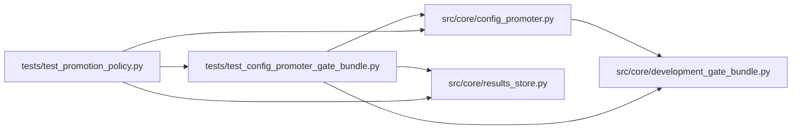

# test_config_promoter_gate_bundle Module

**Path:** `tests/test_config_promoter_gate_bundle.py`

## Description

_Auto-generated from `tests/test_config_promoter_gate_bundle.py`._

## Imports

| Source | Symbols |
|--------|---------|
| `__future__` | `annotations` |
| `json` | `json` |
| `os` | `os` |
| `pathlib` | `Path` |
| `pytest` | `pytest` |
| `src.core` | `config_promoter` |
| `src.core.config_promoter` | `ConfigPromoter` |
| `src.core.development_gate_bundle` | `DEFAULT_GATE_BUNDLE_RELATIVE_PATH`, `PRODUCTION_GATE_BUNDLE_RELATIVE_PATH`, `evaluate_development_gate_bundle` |
| `src.core.results_store` | `ResultsStore` |

## Local dependency map

<!-- Auto-generated local dependency summary. Do not edit by hand. -->

### Internal neighbors

| Direction | Module |
|---|---|
| Inbound | [test_promotion_policy](../modules/test_promotion_policy.md) |
| Outbound | [config_promoter](../modules/config_promoter.md) |
| Outbound | [development_gate_bundle](../modules/development_gate_bundle.md) |
| Outbound | [results_store](../modules/results_store.md) |

### External packages

| Language | Used packages | Undeclared packages |
|---|---:|---:|
| python | 1 | 1 |

## Classes

| Class | Line | Bases | Description |
|-------|------|-------|-------------|
| [FakePromotionStore](../entities/test_config_promoter_gate_bundle_FakePromotionStore.md) | 22 | — | — |
| [FakeMlflowResponse](../entities/FakeMlflowResponse.md) | 687 | — | — |
| [FakeMlflowAsyncClient](../entities/FakeMlflowAsyncClient.md) | 697 | — | — |

## Functions

| Function | Signature | Decorators | Description |
|----------|-----------|------------|-------------|
| `_write_gate_bundle` | `(root: Path) -> None` | — | — |
| `_write_production_gate_bundle` | `(root: Path) -> None` | — | — |
| `_write_gate_bundle_with_rl` | `(root: Path) -> None` | — | — |
| `_write_gate_bundle_with_m7_controls` | `(root: Path) -> None` | — | — |
| `_write_gate_bundle_with_m7_remaining` | `(root: Path) -> None` | — | — |
| `_passing_metrics` | `() -> dict` | — | — |
| `_passing_rl_oos` | `() -> dict` | — | — |
| `_passing_rl_economic_replay` | `() -> dict` | — | — |
| `_passing_m7_remaining_metrics` | `() -> dict` | — | — |
| `_passing_rl_metrics` | `() -> dict` | — | — |
| `_production_scope_metrics` | `() -> dict` | — | — |
| `_approval` | `(*, preview: dict \| None = None) -> dict` | — | — |
| `_promotion_row` | `(scope: str, promotion_id: int = 1) -> dict` | — | — |
| `_development_baseline_promotion` | `(*, best_metric: float \| None = 0.6476, metric_name: str \| None = None, promotion_id: int = 1, promotion_allowed: bool = True, quality_baseline_usable: bool \| None = None, quality_baseline_unusable: bool \| None = None, rolled_back_at: str \| None = None, composite_formula_version: str \| None = None) -> dict` | — | — |
| `_install_fake_mlflow_client` | `(monkeypatch, *, composites: list[dict], promote_payload: dict \| None = None, promote_status_code: int = 200) -> FakeMlflowAsyncClient` | — | — |
| `_best_iteration` | `(metrics: dict, *, primary_metric: float \| None = 0.61, metric_name: str \| None = None) -> dict` | — | — |
| `test_model_version_tag_prefers_serving_and_ensemble_fields` | `()` | — | — |
| `test_preview_includes_blocking_gate_bundle_result` | *(async)* `(tmp_path, monkeypatch)` | `@pytest.mark.asyncio` | — |
| `test_preview_blocks_weak_calibration_and_signal_saturation_exactly` | *(async)* `(tmp_path, monkeypatch)` | `@pytest.mark.asyncio` | — |
| `test_preview_blocks_unstable_fold_thresholds` | *(async)* `(tmp_path, monkeypatch)` | `@pytest.mark.asyncio` | — |
| `test_preview_blocks_worsening_post_cost_replay_even_if_replay_gates_pass` | *(async)* `(tmp_path, monkeypatch)` | `@pytest.mark.asyncio` | — |
| `test_confirm_requires_development_gate_bundle_pass` | *(async)* `(tmp_path, monkeypatch)` | `@pytest.mark.asyncio` | — |
| `test_preview_allows_feature_candidate_without_economic_replay` | *(async)* `(tmp_path, monkeypatch)` | `@pytest.mark.asyncio` | — |
| `test_preview_blocks_metric_below_development_baseline` | *(async)* `(tmp_path, monkeypatch)` | `@pytest.mark.asyncio` | — |
| `test_preview_allows_metric_within_or_above_development_baseline` | *(async)* `(tmp_path, monkeypatch, current_metric, baseline_metric)` | `@pytest.mark.asyncio`, `@pytest.mark.parametrize(('current_metric', 'baseline_metric'), [(0.61, 0.61005), (0.62, 0.61)])` | — |
| `test_preview_skips_ineligible_development_quality_baselines` | *(async)* `(tmp_path, monkeypatch, baseline)` | `@pytest.mark.asyncio`, `@pytest.mark.parametrize('baseline', [_development_baseline_promotion(best_metric=0.6476, quality_baseline_usable=False), _development_baseline_promotion(best_metric=0.6476, quality_baseline_unusable=True), _development_baseline_promotion(best_metric=0.6476, promotion_allowed=False), _development_baseline_promotion(best_metric=0.6476, rolled_back_at='2026-05-01T00:00:00+00:00'), _development_baseline_promotion(best_metric=None)])` | — |
| `test_preview_skips_quality_baseline_metric_name_mismatch` | *(async)* `(tmp_path, monkeypatch)` | `@pytest.mark.asyncio` | — |
| `test_preview_skips_quality_baseline_formula_version_mismatch` | *(async)* `(tmp_path, monkeypatch)` | `@pytest.mark.asyncio` | R3: a v6 champion below a v5 baseline numerically must NOT be blocked — |
| `test_preview_without_smoke_evidence_uses_recorded_metrics` | *(async)* `(tmp_path, monkeypatch)` | `@pytest.mark.asyncio` | With the platform evidence collector removed, preview evaluates the |
| `test_preview_passes_when_baseline_predates_version_stamp` | *(async)* `(tmp_path, monkeypatch)` | `@pytest.mark.asyncio` | A current-formula champion must NOT be blocked by a LEGACY baseline that |
| `test_preview_blocks_same_formula_regression` | *(async)* `(tmp_path, monkeypatch)` | `@pytest.mark.asyncio` | Guard: SAME formula version still does the strict numeric compare — a |
| `test_confirm_requires_quality_baseline_pass` | *(async)* `(tmp_path, monkeypatch)` | `@pytest.mark.asyncio` | — |
| `test_preview_rebuilds_sweep_consistency_as_promotion_mode` | *(async)* `(tmp_path, monkeypatch)` | `@pytest.mark.asyncio` | — |
| `test_confirm_requires_cross_service_consistency` | *(async)* `(tmp_path, monkeypatch)` | `@pytest.mark.asyncio` | — |
| `test_preview_blocks_adaptive_finalist_missing_schema_flags` | *(async)* `(tmp_path, monkeypatch)` | `@pytest.mark.asyncio` | — |
| `test_confirm_records_promotion_when_bundle_passes` | *(async)* `(tmp_path, monkeypatch)` | `@pytest.mark.asyncio` | — |
| `test_preview_blocks_live_production_promotion_intent` | *(async)* `(tmp_path, monkeypatch)` | `@pytest.mark.asyncio` | — |
| `test_preview_blocks_missing_required_inference_parity` | *(async)* `(tmp_path, monkeypatch)` | `@pytest.mark.asyncio` | — |
| `test_confirm_persists_development_metadata_with_results_store` | *(async)* `(tmp_path, monkeypatch)` | `@pytest.mark.asyncio` | — |
| `test_production_scope_blocks_without_paper_and_canary` | *(async)* `(tmp_path, monkeypatch)` | `@pytest.mark.asyncio` | — |
| `test_production_scope_records_full_decision_chain` | *(async)* `(tmp_path, monkeypatch)` | `@pytest.mark.asyncio` | — |
| `test_paper_scope_remains_local_only` | *(async)* `(tmp_path, monkeypatch)` | `@pytest.mark.asyncio` | — |
| `test_preview_blocks_finalist_with_proxy_direction_rl_oos` | *(async)* `(tmp_path, monkeypatch)` | `@pytest.mark.asyncio` | — |
| `test_preview_accepts_finalist_with_honest_rl_oos` | *(async)* `(tmp_path, monkeypatch)` | `@pytest.mark.asyncio` | — |
| `test_preview_accepts_rl_candidate_with_honest_oos_provenance` | *(async)* `(tmp_path, monkeypatch)` | `@pytest.mark.asyncio` | — |
| `test_preview_blocks_rl_candidate_missing_economic_replay` | *(async)* `(tmp_path, monkeypatch)` | `@pytest.mark.asyncio` | — |
| `test_preview_blocks_rl_candidate_worsening_economic_replay` | *(async)* `(tmp_path, monkeypatch)` | `@pytest.mark.asyncio` | — |
| `test_preview_blocks_rl_candidate_missing_volatility_provenance` | *(async)* `(tmp_path, monkeypatch)` | `@pytest.mark.asyncio` | — |
| `test_preview_blocks_rl_candidate_with_volatility_fallback` | *(async)* `(tmp_path, monkeypatch)` | `@pytest.mark.asyncio` | — |
| `test_preview_blocks_rl_candidate_without_nested_or_multi_seed_oos` | *(async)* `(tmp_path, monkeypatch)` | `@pytest.mark.asyncio` | — |
| `test_preview_derives_addressable_rollback_and_smoke_readiness` | *(async)* `(tmp_path, monkeypatch)` | `@pytest.mark.asyncio` | — |
| `test_confirm_writes_rollback_snapshot_and_rollback_restores_previous_config` | *(async)* `(tmp_path, monkeypatch)` | `@pytest.mark.asyncio` | — |
| `test_preview_blocks_tsfm_candidate_without_fallback_check` | *(async)* `(tmp_path, monkeypatch)` | `@pytest.mark.asyncio` | — |
| `test_preview_records_tsfm_fallback_check_when_present` | *(async)* `(tmp_path, monkeypatch)` | `@pytest.mark.asyncio` | — |
| `test_preview_accepts_structured_tsfm_fallback_validation` | *(async)* `(tmp_path, monkeypatch)` | `@pytest.mark.asyncio` | — |
| `test_preview_emits_development_signal_health_metrics` | *(async)* `(tmp_path, monkeypatch)` | `@pytest.mark.asyncio` | — |
| `test_preview_blocks_missing_development_signal_health_metrics` | *(async)* `(tmp_path, monkeypatch)` | `@pytest.mark.asyncio` | — |
| `test_preview_records_inference_reload_validation` | *(async)* `(tmp_path, monkeypatch)` | `@pytest.mark.asyncio` | — |
| `test_inference_reload_uses_generic_adapter_blocker_for_tabular_candidate` | `()` | — | — |
| `test_confirm_blocks_reload_failure_before_replacing_prior_config` | *(async)* `(tmp_path, monkeypatch)` | `@pytest.mark.asyncio` | — |
