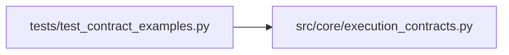

# test_contract_examples Module

**Path:** `tests/test_contract_examples.py`

## Description

Tests for the serialized contract examples under examples/contracts/v1/.

Every example bundle must validate against the contract models and
round-trip through JSON unchanged.

## Imports

| Source | Symbols |
|--------|---------|
| `__future__` | `annotations` |
| `json` | `json` |
| `pathlib` | `Path` |
| `pytest` | `pytest` |
| `src.core` | `execution_contracts` |
| `typing` | `Any` |

## Local dependency map

<!-- Auto-generated local dependency summary. Do not edit by hand. -->

### Internal neighbors

| Direction | Module |
|---|---|
| Outbound | [execution_contracts](../modules/execution_contracts.md) |

### External packages

| Language | Used packages | Undeclared packages |
|---|---:|---:|
| python | 1 | 1 |

## Functions

| Function | Signature | Decorators | Description |
|----------|-----------|------------|-------------|
| `_bundles` | `() -> list[tuple[str, dict[str, Any]]]` | — | — |
| `_bundle` | `(name: str) -> dict[str, Any]` | — | — |
| `_round_trip` | `(model: type, payload: dict[str, Any]) -> Any` | — | — |
| `test_every_example_file_parses_with_identity_fields` | `() -> None` | — | — |
| `test_integration_bundles_cover_both_directions_and_three_domains` | `() -> None` | — | — |
| `test_integration_bundle_contracts_validate_and_agree` | `(name: str) -> None` | `@pytest.mark.parametrize('name', [f'{integration}-{domain}' for domain in sorted(DOMAIN_DIRECTIONS) for integration in ('managed', 'attached')])` | — |
| `test_integration_bundles_reference_no_raw_credentials` | `() -> None` | — | — |
| `test_review_failure_example_claims_no_metrics` | `() -> None` | — | — |
| `test_review_continuation_preserves_lineage_and_nondefaults` | `() -> None` | — | — |
| `test_review_minimization_selects_the_lower_measurement` | `() -> None` | — | — |
| `test_review_unsupported_capability_is_rejected_before_work` | `() -> None` | — | — |
| `test_legacy_compatibility_example_matches_the_code_mapping` | `() -> None` | — | — |
