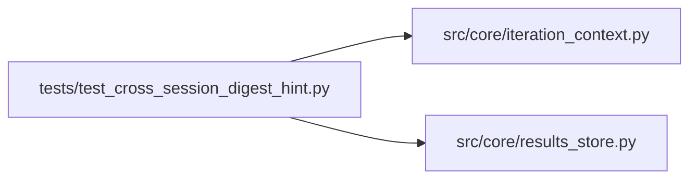

# test_cross_session_digest_hint Module

**Path:** `tests/test_cross_session_digest_hint.py`

## Description

Fix B / Fix C — cross-session iteration summary + digest sections.

Fix B-1 validates the new ResultsStore method.
Fix B-2 + C validate the new digest sections in
``build_iteration_context_digest``:

  - "Tried in prior sessions ({N} canonical configs, best={metric})"
  - "Server-side feature availability:"

## Imports

| Source | Symbols |
|--------|---------|
| `__future__` | `annotations` |
| `json` | `json` |
| `pathlib` | `Path` |
| `pytest` | `pytest` |
| `src.core.iteration_context` | `build_iteration_context_digest` |
| `src.core.results_store` | `ResultsStore` |

## Local dependency map

<!-- Auto-generated local dependency summary. Do not edit by hand. -->

### Internal neighbors

| Direction | Module |
|---|---|
| Outbound | [iteration_context](../modules/iteration_context.md) |
| Outbound | [results_store](../modules/results_store.md) |

### External packages

| Language | Used packages | Undeclared packages |
|---|---:|---:|
| python | 1 | 1 |

## Functions

| Function | Signature | Decorators | Description |
|----------|-----------|------------|-------------|
| `_make_session` | *(async)* `(store: ResultsStore, sid: str, *, instrument: str = 'DOGE_USDT', timeframe: str = '15m', model_type: str = 'direction') -> None` | — | — |
| `_add_iter` | *(async)* `(store: ResultsStore, sid: str, iteration: int, *, primary_metric: float, canonical_config_hash: str, decision: str = 'keep', metrics_extra: dict \| None = None, config_snapshot: str = 'instrument: DOGE_USDT\n', duplicate_reason: str \| None = None) -> None` | — | — |
| `test_cross_session_summary_groups_by_hash_and_excludes_current` | *(async)* `(tmp_path: Path) -> None` | `@pytest.mark.asyncio` | — |
| `test_cross_session_summary_skips_other_instruments` | *(async)* `(tmp_path: Path) -> None` | `@pytest.mark.asyncio` | — |
| `test_cross_session_summary_captures_noop_reasons` | *(async)* `(tmp_path: Path) -> None` | `@pytest.mark.asyncio` | noop_reasons / tsfm_* columns must surface so the digest can emit |
| `_session_stub` | `() -> dict` | — | — |
| `test_digest_emits_tried_in_prior_sessions_block` | `() -> None` | — | — |
| `test_digest_omits_tried_section_when_summary_empty` | `() -> None` | — | — |
| `test_digest_caps_prior_session_entries_to_twelve` | `() -> None` | — | 20 distinct-signature direction configs → 20 distinct clusters → |
| `test_digest_emits_feature_unavailable_when_threshold_met` | `() -> None` | — | — |
| `test_digest_omits_availability_below_threshold` | `() -> None` | — | — |
| `test_digest_emits_tsfm_fallback_when_no_real_adapter` | `() -> None` | — | — |
| `test_cross_session_summary_includes_discard_rows` | *(async)* `(tmp_path: Path) -> None` | `@pytest.mark.asyncio` | Fix B-1: prior-session iterations that ended in decision='discard' |
| `test_cross_session_summary_excludes_duplicate_reason_rows` | *(async)* `(tmp_path: Path) -> None` | `@pytest.mark.asyncio` | Fix B-1: rows where ``duplicate_reason`` is set are dedup-engine |
| `test_digest_renders_parameter_signature_when_snapshot_available` | `() -> None` | — | — |
| `test_digest_falls_back_to_hash_when_snapshot_missing` | `() -> None` | — | — |
| `test_digest_signature_renders_list_compactly_for_rl` | `() -> None` | — | RL salient knobs include list-valued ``net_arch_pi``. |
| `test_digest_signature_skips_unknown_model_type` | `() -> None` | — | Unknown model_type → no salient-keys map → fallback to hash-only. |
| `test_summary_returns_sample_config_snapshot_column` | *(async)* `(tmp_path: Path) -> None` | `@pytest.mark.asyncio` | End-to-end: the new ``sample_config_snapshot`` column populates |
| `_direction_summary_row` | `(idx: int, *, pct: float, purge: float, metric: float, rid: str \| None = None) -> dict` | — | — |
| `test_clustering_groups_near_duplicate_configs` | `() -> None` | — | 20 configs whose direction_pct_threshold ∈ {0.050,0.051,0.052} |
| `test_hybrid_selection_includes_top_and_spread` | `() -> None` | — | 40 configs spanning metric 0.50→0.65 across distinct purge bands: |
| `test_unsignatured_rows_fall_back_to_hash` | `() -> None` | — | — |
| `test_unknown_model_type_preserves_legacy_hash_render` | `() -> None` | — | — |
| `test_digest_is_deterministic` | `() -> None` | — | — |
| `test_rl_log_bucket_groups_same_order_of_magnitude` | `() -> None` | — | — |
| `test_empty_summary_unchanged` | `() -> None` | — | — |
