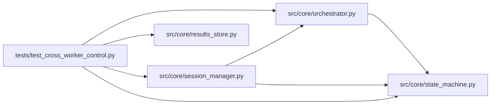

# test_cross_worker_control Module

**Path:** `tests/test_cross_worker_control.py`

## Description

ARC-011 implementation review C5 (2026-08-15) — cross-worker control at
the SessionManager entry point (P6-004 / H3).

The review found ``stop_session`` / ``pause_session`` / ``resume_session`` /
``stop_pipeline`` all began with an ``_active``-registry early return BEFORE
writing any DB intent. Under ``WEB_CONCURRENCY > 1`` with a non-sticky load
balancer, a control request routed to a worker that does not own the session
returned False and wrote nothing — the owning worker's DB-side polls (the H3
machinery) never fired, contradicting ADR §6.2's own design ("worker B writes
the transition"). The fencing tests bypassed ``SessionManager`` entirely, so
the gap was untested.

These tests pin the fixed contract: DB intent is recorded regardless of
local ownership; local ownership only adds the fast path (in-process flag +
task drain). Plus the orchestrator-side pause observation (``_wait_while_paused``
now reads the authoritative DB status — a DB-side ``paused`` is observed by a
non-paused owner, and a cross-worker resume unsticks a locally-paused owner).

## Imports

| Source | Symbols |
|--------|---------|
| `__future__` | `annotations` |
| `anthropic` | `anthropic` |
| `asyncio` | `asyncio` |
| `datetime` | `datetime`, `timezone` |
| `os` | `os` |
| `pathlib` | `Path` |
| `pytest` | `pytest` |
| `src.core.orchestrator` | `AgentOrchestrator` |
| `src.core.results_store` | `ResultsStore` |
| `src.core.session_manager` | `session_manager_module`, `ActiveSession`, `SessionManager` |
| `src.core.state_machine` | `IllegalTransitionError`, `SessionEvent` |
| `sys` | `sys` |
| `types` | `types`, `ModuleType` |
| `typing` | `Any`, `Dict`, `List`, `cast` |
| `unittest.mock` | `MagicMock` |

## Local dependency map

<!-- Auto-generated local dependency summary. Do not edit by hand. -->

### Internal neighbors

| Direction | Module |
|---|---|
| Outbound | [orchestrator](../modules/orchestrator.md) |
| Outbound | [results_store](../modules/results_store.md) |
| Outbound | [session_manager](../modules/session_manager.md) |
| Outbound | [state_machine](../modules/state_machine.md) |

### External packages

| Language | Used packages | Undeclared packages |
|---|---:|---:|
| python | 2 | 2 |

## Classes

| Class | Line | Bases | Description |
|-------|------|-------|-------------|
| [ControlFakeOrchestrator](../entities/ControlFakeOrchestrator.md) | 55 | — | Records control requests; never actually runs anything. |

## Functions

| Function | Signature | Decorators | Description |
|----------|-----------|------------|-------------|
| `_seed_running_session` | *(async)* `(store: ResultsStore, research_id: str) -> None` | — | — |
| `_manager_with_fake_orchestrator` | `(monkeypatch: pytest.MonkeyPatch, store: ResultsStore) -> tuple[SessionManager, ControlFakeOrchestrator]` | — | — |
| `test_stop_on_non_owning_worker_records_db_intent` | *(async)* `(monkeypatch, tmp_path)` | `@pytest.mark.asyncio` | The C5 headline: worker B (empty ``_active``) stops a session owned by |
| `test_stop_unknown_session_returns_false` | *(async)* `(monkeypatch, tmp_path)` | `@pytest.mark.asyncio` | — |
| `test_stop_terminal_session_is_idempotent_no_op` | *(async)* `(monkeypatch, tmp_path)` | `@pytest.mark.asyncio` | — |
| `test_pause_and_resume_on_non_owning_worker` | *(async)* `(monkeypatch, tmp_path)` | `@pytest.mark.asyncio` | — |
| `test_local_owner_fast_path_unchanged` | *(async)* `(monkeypatch, tmp_path)` | `@pytest.mark.asyncio` | Owning worker: the DB intent is still written AND the in-process flag |
| `test_wait_while_paused_observes_db_side_pause` | *(async)* `(tmp_path)` | `@pytest.mark.asyncio` | A non-paused owner (local flag clear) must still wait while the shared |
| `test_wait_while_paused_honors_cross_worker_resume` | *(async)* `(tmp_path)` | `@pytest.mark.asyncio` | A locally-paused owner (flag set) unsticks when the DB says ``running`` |
| `_seed_running_pipeline` | *(async)* `(store: ResultsStore, pipeline_id: str) -> None` | — | — |
