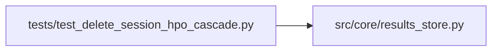

# test_delete_session_hpo_cascade Module

**Path:** `tests/test_delete_session_hpo_cascade.py`

## Description

Regression: delete_session must remove ALL research_id children — including
hpo_studies — before the parent row. Previously hpo_studies was omitted, so RL/
structured-HPO sessions (which create study rows) hit SQLite
'FOREIGN KEY constraint failed' and could never be deleted.

## Imports

| Source | Symbols |
|--------|---------|
| `__future__` | `annotations` |
| `json` | `json` |
| `os` | `os` |
| `pathlib` | `Path` |
| `pytest` | `pytest` |
| `src.core.results_store` | `ResultsStore` |

## Local dependency map

<!-- Auto-generated local dependency summary. Do not edit by hand. -->

### Internal neighbors

| Direction | Module |
|---|---|
| Outbound | [results_store](../modules/results_store.md) |

### External packages

| Language | Used packages | Undeclared packages |
|---|---:|---:|
| python | 1 | 1 |

## Functions

| Function | Signature | Decorators | Description |
|----------|-----------|------------|-------------|
| `_make_session` | *(async)* `(store: ResultsStore, sid: str, tmp_path: Path)` | — | — |
| `test_delete_session_with_hpo_study_succeeds` | *(async)* `(tmp_path: Path)` | `@pytest.mark.asyncio` | — |
| `test_delete_missing_session_returns_false` | *(async)* `(tmp_path: Path)` | `@pytest.mark.asyncio` | — |
