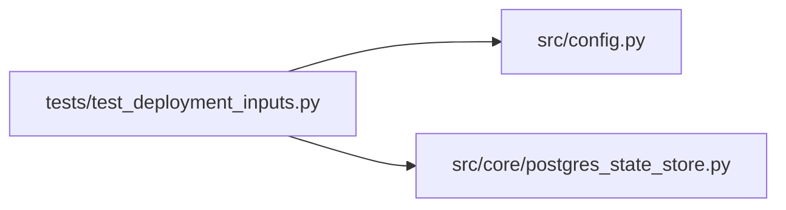

# test_deployment_inputs Module

**Path:** `tests/test_deployment_inputs.py`

## Description

_Auto-generated from `tests/test_deployment_inputs.py`._

## Imports

| Source | Symbols |
|--------|---------|
| `__future__` | `annotations` |
| `json` | `json` |
| `os` | `os` |
| `pathlib` | `Path` |
| `pytest` | `pytest` |
| `shutil` | `shutil` |
| `src.config` | `Settings`, `Settings` |
| `src.core.postgres_state_store` | `is_postgres_dsn` |
| `subprocess` | `subprocess` |
| `yaml` | `yaml` |

## Local dependency map

<!-- Auto-generated local dependency summary. Do not edit by hand. -->

### Internal neighbors

| Direction | Module |
|---|---|
| Outbound | [config](../modules/config.md) |
| Outbound | [postgres_state_store](../modules/postgres_state_store.md) |

### External packages

| Language | Used packages | Undeclared packages |
|---|---:|---:|
| python | 2 | 1 |

## Functions

| Function | Signature | Decorators | Description |
|----------|-----------|------------|-------------|
| `_git` | `(*args: str) -> subprocess.CompletedProcess[str]` | — | — |
| `test_env_example_exists_and_contains_only_sanitized_values` | `()` | — | — |
| `test_autoresearch_ui_build_inputs_are_tracked_and_outputs_ignored` | `()` | — | — |
| `test_autoresearch_backend_uses_src_layout_and_committed_lockfile` | `()` | — | — |
| `test_autoresearch_dockerfile_matches_standalone_runtime_contract` | `()` | — | — |
| `test_autoresearch_deployment_documents_single_instance_constraint` | `()` | — | — |
| `test_readme_uses_tracked_env_template_without_token_samples` | `()` | — | — |
| `test_settings_initializes_in_demo_mode_without_credentials` | `(monkeypatch)` | — | — |
| `test_compose_uses_unset_only_database_default_and_loopback_binding` | `()` | — | — |
| `test_compose_resolves_database_overrides` | `(tmp_path, dotenv_dsn, shell_dsn, expected)` | `@pytest.mark.parametrize(('dotenv_dsn', 'shell_dsn', 'expected'), [(None, None, DEFAULT_POSTGRES_DSN), ('', None, ''), ('postgresql://custom/db', None, 'postgresql://custom/db'), ('postgresql://custom/db', '', ''), ('', 'postgresql://shell/db', 'postgresql://shell/db')])` | Render with Compose itself (no daemon, containers or network required). |
| `test_explicit_empty_database_url_selects_sqlite` | `(monkeypatch)` | — | — |
