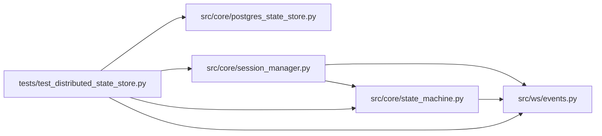

# test_distributed_state_store Module

**Path:** `tests/test_distributed_state_store.py`

## Description

ARC-011 P6-007 — distributed concurrency tests (the Phase-6 exit gate).

Real multi-process + real Postgres. Spawns N worker subprocesses (each its own
asyncio loop + its own ``PostgresStateStore`` sharing the same DB) via
``multiprocessing`` to validate the cross-process guarantees that
single-process tests cannot:

* H1 — atomic idempotency reserve across processes (exactly one winner)
* H2 — cross-process transition serialization (the W8 race, now cross-worker)
* H4 — fencing-token stale-write rejection across processes

These complement the in-process tests in ``test_fencing_tokens.py`` /
``test_postgres_state_store.py`` (which prove the same contracts within one
process). The distributed tests prove the contracts hold across real OS
processes sharing a pool/DB — the actual WEB_CONCURRENCY>1 deployment shape.

Skipped when ``AUTORESEARCH_DATABASE_URL`` is unset (default CI run). The
dedicated ``distributed`` CI job wires a Postgres service + the DSN.

## Imports

| Source | Symbols |
|--------|---------|
| `__future__` | `annotations` |
| `asyncio` | `asyncio` |
| `asyncpg` | `asyncpg`, `asyncpg` |
| `multiprocessing` | `mp` |
| `os` | `os` |
| `pytest` | `pytest` |
| `src.core.postgres_state_store` | `PostgresStateStore`, `PostgresStateStore`, `PostgresStateStore` |
| `src.core.session_manager` | `SessionManager` |
| `src.core.state_machine` | `SessionStateMachine` |
| `src.ws.events` | `EventBroadcaster` |
| `sys` | `sys` |
| `typing` | `Any` |
| `uuid` | `uuid` |

## Local dependency map

<!-- Auto-generated local dependency summary. Do not edit by hand. -->

### Internal neighbors

| Direction | Module |
|---|---|
| Outbound | [postgres_state_store](../modules/postgres_state_store.md) |
| Outbound | [session_manager](../modules/session_manager.md) |
| Outbound | [state_machine](../modules/state_machine.md) |
| Outbound | [events](../modules/events.md) |

### External packages

| Language | Used packages | Undeclared packages |
|---|---:|---:|
| python | 2 | 1 |

## Functions

| Function | Signature | Decorators | Description |
|----------|-----------|------------|-------------|
| `_pool_only_store` | *(async)* `(dsn: str)` | — | Construct a PostgresStateStore with a pool but NO schema DDL. |
| `_base_dsn` | `() -> str \| None` | — | — |
| `_worker_attempt_idempotency` | `(dsn: str, op: str, parent_id: str, key_hash: str) -> dict[str, Any]` | — | Child: try to reserve an idempotency key; return whether it won. |
| `_worker_stop_session` | `(dsn: str, sid: str, actor: str) -> dict[str, Any]` | — | Child: drive a stop transition on the shared session. |
| `_worker_stale_write` | `(dsn: str, sid: str, captured_epoch: int) -> dict[str, Any]` | — | Child: attempt a fenced update with a (stale) captured epoch. |
| `pg_dsn` | *(async)* `()` | `@pytest.fixture()` | A throwaway DB shared across the test; skip if no Postgres. |
| `pg_store` | *(async)* `(pg_dsn)` | `@pytest.fixture()` | — |
| `_seed` | *(async)* `(store, sid: str) -> None` | — | — |
| `_spawn` | `(fn, *args, n: int = 8) -> list` | — | Spawn n worker processes running fn(*args); collect results. |
| `test_distributed_idempotency_exactly_one_winner` | *(async)* `(pg_dsn)` | — | H1 across processes: N workers race the same idempotency key; exactly |
| `test_distributed_cross_worker_stop_serialized` | *(async)* `(pg_store, pg_dsn)` | — | H2 across processes: two workers race stop vs complete on the same |
| `test_distributed_fencing_rejects_stale_write` | *(async)* `(pg_store, pg_dsn)` | — | H4 across processes: worker A captures an epoch, worker B stops the |
| `test_distributed_fresh_epoch_write_accepted` | *(async)* `(pg_store, pg_dsn)` | — | The fence only rejects STALE epochs: a write with the current epoch |
| `_worker_session_manager_stop` | `(dsn: str, sid: str) -> dict[str, Any]` | — | Child: stop a session through the REAL SessionManager entry point. |
| `test_distributed_session_manager_stop_records_intent` | *(async)* `(pg_store, pg_dsn)` | — | H3 through the real entry point, across processes: a worker that does |
