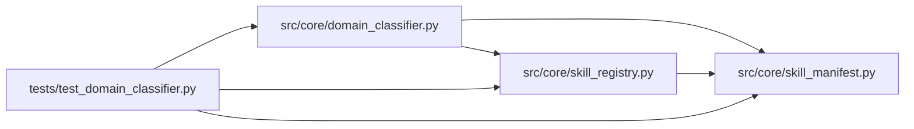

# test_domain_classifier Module

**Path:** `tests/test_domain_classifier.py`

## Description

Domain classifier tests (ARC-011 P5-016..020).

Covers the lexical-first classifier:

* **P5-016** — ranks installed skills by similarity to a ``goal``; embeddings
  cached + invalidated on reload; cold-start degrades to "list all".
* **P5-018** — ``ClassificationResult.to_audit_dict()`` shape for the
  ``skill.classify`` audit row.
* **P5-019** — threshold + confidence logic (high/medium/low, auto-select).

The classifier is built on a temp ``SkillRegistry`` stubbed with hand-authored
skill manifests so the lexical similarity is deterministic and observable.

## Imports

| Source | Symbols |
|--------|---------|
| `__future__` | `annotations` |
| `json` | `json` |
| `pathlib` | `Path` |
| `pytest` | `pytest` |
| `src.core.domain_classifier` | `DEFAULT_AUTO_SELECT_THRESHOLD`, `ClassificationResult`, `DomainClassifier`, `LexicalEmbeddingBackend`, `SkillMatch` |
| `src.core.skill_manifest` | `SCHEMA_VERSION` |
| `src.core.skill_registry` | `SKILL_MANIFEST_FILENAME`, `SkillRegistry` |
| `typing` | `Any` |
| `yaml` | `yaml` |

## Local dependency map

<!-- Auto-generated local dependency summary. Do not edit by hand. -->

### Internal neighbors

| Direction | Module |
|---|---|
| Outbound | [domain_classifier](../modules/domain_classifier.md) |
| Outbound | [skill_manifest](../modules/skill_manifest.md) |
| Outbound | [skill_registry](../modules/skill_registry.md) |

### External packages

| Language | Used packages | Undeclared packages |
|---|---:|---:|
| python | 2 | 1 |

## Classes

| Class | Line | Bases | Description |
|-------|------|-------|-------------|
| [_StubSettings](../entities/test_domain_classifier_StubSettings.md) | 67 | — | Minimal settings object (the manifests here use no {settings.*} refs). |
| [TestClassifyRanking](../entities/TestClassifyRanking.md) | 104 | — | — |
| [TestThresholdAndConfidence](../entities/TestThresholdAndConfidence.md) | 130 | — | — |
| [TestEmbeddingCache](../entities/TestEmbeddingCache.md) | 162 | — | — |
| [TestAuditShape](../entities/TestAuditShape.md) | 195 | — | — |
| [TestEmbeddingBackend](../entities/TestEmbeddingBackend.md) | 217 | — | — |

## Functions

| Function | Signature | Decorators | Description |
|----------|-----------|------------|-------------|
| `_manifest_dict` | `(*, skill_id: str, display_name: str, description: str, category: str = 'optimization') -> dict[str, Any]` | — | — |
| `registry_with_skills` | `(tmp_path: Path) -> SkillRegistry` | `@pytest.fixture()` | A registry with three distinct-domain skills for classification. |
