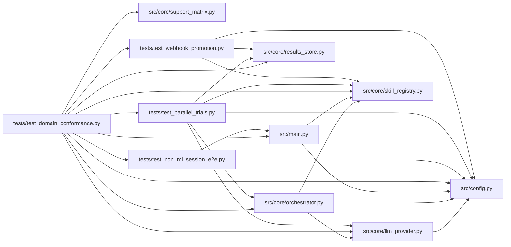

# test_domain_conformance Module

**Path:** `tests/test_domain_conformance.py`

## Description

Domain conformance: complete workflows over the supported declarations.

Each case materializes a small fixture skill with a fresh identity (data
only — no core or UI edits), drops it into the skills root, and drives the
real API/session paths end to end on the scripted demo provider: session
start, governed experiment execution, result parsing through the declared
parser, iteration recording, winner selection through the declared
objective, and promotion preview/confirmation through the declared scope
shape. Unsupported extensions and parameter violations must fail before any
side effect.

The catalog is checked mechanically against the published support matrix so
every supported declaration value carries execution evidence, and a
machine-readable conformance report can be emitted to the qualification
workspace (set CONFORMANCE_REPORT_PATH).

## Imports

| Source | Symbols |
|--------|---------|
| `__future__` | `annotations` |
| `fastapi.testclient` | `TestClient`, `TestClient`, `TestClient` |
| `httpx` | `httpx` |
| `json` | `json` |
| `os` | `os` |
| `pathlib` | `Path` |
| `pytest` | `pytest` |
| `src.config` | `settings`, `settings` |
| `src.core` | `skill_registry`, `orchestrator`, `skill_registry` |
| `src.core.llm_provider` | `ProviderResponse`, `StopReason`, `TextBlock`, `ToolUseBlock`, `Usage`, `ProviderCapabilities`, `ErrorClass` |
| `src.core.orchestrator` | `AgentOrchestrator`, `ResearchConfig` |
| `src.core.results_store` | `ResultsStore` |
| `src.core.support_matrix` | `ACCEPTED_ADVISORY`, `SUPPORT_MATRIX` |
| `src.main` | `app`, `app`, `app` |
| `sys` | `sys` |
| `tests.test_non_ml_session_e2e` | `API_TOKEN`, `_auth`, `_poll_terminal`, `_preserve_lifespan_globals` |
| `tests.test_parallel_trials` | `_ScriptedProvider` |
| `tests.test_webhook_promotion` | `_patch_mock_transport` |
| `time` | `time` |
| `unittest.mock` | `AsyncMock`, `patch` |
| `yaml` | `yaml` |

## Local dependency map

<!-- Auto-generated local dependency summary. Do not edit by hand. -->

### Internal neighbors

| Direction | Module |
|---|---|
| Outbound | [config](../modules/config.md) |
| Outbound | [llm_provider](../modules/llm_provider.md) |
| Outbound | [orchestrator](../modules/orchestrator.md) |
| Outbound | [results_store](../modules/results_store.md) |
| Outbound | [skill_registry](../modules/skill_registry.md) |
| Outbound | [support_matrix](../modules/support_matrix.md) |
| Outbound | [src_main](../modules/src_main.md) |
| Outbound | [test_non_ml_session_e2e](../modules/test_non_ml_session_e2e.md) |
| Outbound | [test_parallel_trials](../modules/test_parallel_trials.md) |
| Outbound | [test_webhook_promotion](../modules/test_webhook_promotion.md) |

### External packages

| Language | Used packages | Undeclared packages |
|---|---:|---:|
| python | 4 | 2 |

## Classes

| Class | Line | Bases | Description |
|-------|------|-------|-------------|
| [_OnePerTurnScriptedProvider](../entities/OnePerTurnScriptedProvider.md) | 647 | — | Issues one candidate command per turn (the sequential execution path). |

## Functions

| Function | Signature | Decorators | Description |
|----------|-----------|------------|-------------|
| `_materialize_skill` | `(skills_root: Path, skill_id: str, manifest: dict) -> Path` | — | Drop one fixture skill directory (SKILL.yaml + primer + evaluator). |
| `conformance_env` | `(monkeypatch: pytest.MonkeyPatch, tmp_path: Path)` | `@pytest.fixture` | Hermetic deployment: tmp workspace + tmp skills root + demo mode. |
| `_start` | `(client, body: dict)` | — | — |
| `_case_manifest` | `(case: dict) -> dict` | — | One fixture-skill manifest declaring exactly the case's axes. |
| `test_complete_workflow_for_declared_axes` | `(conformance_env, monkeypatch, case)` | `@pytest.mark.parametrize('case', CONFORMANCE_CASES, ids=lambda c: c['case_id'])` | Start → governed eval → parsed observations → selection → preview. |
| `test_unsupported_extensions_fail_before_side_effects` | `(conformance_env, label, override)` | `@pytest.mark.parametrize('label, override', UNSUPPORTED_EXTENSIONS, ids=[label for label, _ in UNSUPPORTED_EXTENSIONS])` | — |
| `test_parameter_violations_fail_before_side_effects` | `(conformance_env, label, bad_params)` | `@pytest.mark.parametrize('label, bad_params', PARAMETER_VIOLATIONS, ids=[label for label, _ in PARAMETER_VIOLATIONS])` | — |
| `_run_observation_session` | *(async)* `(monkeypatch, tmp_path, *, concurrency: int, research_id: str)` | — | — |
| `test_sequential_and_parallel_observations_share_domain_semantics` | *(async)* `(monkeypatch, tmp_path)` | `@pytest.mark.asyncio` | Both observation paths record identical normalized shapes and |
| `_case_ids` | `(**axis_values) -> list[str]` | — | — |
| `_binding_cases` | `(slot: str) -> list[str]` | — | — |
| `_conformance_report` | `() -> dict` | — | — |
| `test_conformance_report_covers_support_matrix` | `()` | — | Every supported declaration value carries execution evidence. |
| `test_no_skill_specific_branch_for_the_fixture_skills` | `()` | — | A conforming new skill needs no core or UI code changes. |
| `test_conformance_report_is_emitted_on_request` | `()` | — | — |
