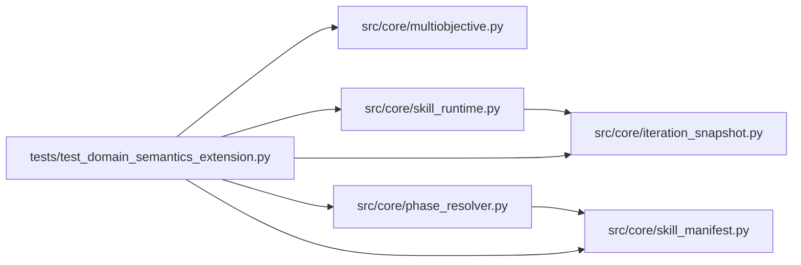

# test_domain_semantics_extension Module

**Path:** `tests/test_domain_semantics_extension.py`

## Description

Domain semantics extension: the two motivating skill cases.

Case 1 (adaptive-phase): a completion rule that adapts to evidence
history resists declarative evidence_keys — the sanctioned
phase_advancement plugin escape now executes under the qualified
isolation rules with attempt-bound receipts. Case 2 (pareto-tradeoff): a
genuine two-metric tradeoff needs Pareto semantics — the scalar primary
contract cannot express it and a scalar proxy is refused.

Both cases are executable agent-authored fixtures (valid technical
evidence per the card). Migration, plugin adversarial containment, and
objective-specific acceptance scenarios are covered; nothing here (or in
the extension) branches on a domain or skill id.

## Imports

| Source | Symbols |
|--------|---------|
| `__future__` | `annotations` |
| `asyncio` | `asyncio` |
| `json` | `json` |
| `pathlib` | `Path` |
| `pydantic` | `ValidationError` |
| `pytest` | `pytest` |
| `src.core.iteration_snapshot` | `UnsupportedIdentityResolveError`, `build_trial_identity` |
| `src.core.multiobjective` | `Candidate`, `MultiObjectiveError`, `ObjectiveMetric`, `ScalarProxyRejected`, `dominates`, `non_dominated`, `objective_metrics_from_spec`, `promotion_frontier`, `scalar_winner_rejected` |
| `src.core.phase_resolver` | `PluginAdvancementFailed`, `PluginAdvancementRejected`, `resolve_phase_advancement` |
| `src.core.skill_manifest` | `PluginEntry`, `ResearchSkillManifest` |
| `src.core.skill_runtime` | `ManifestSkillRuntime`, `UnsupportedPhaseAdvancementError` |
| `typing` | `Any` |
| `yaml` | `yaml` |

## Local dependency map

<!-- Auto-generated local dependency summary. Do not edit by hand. -->

### Internal neighbors

| Direction | Module |
|---|---|
| Outbound | [iteration_snapshot](../modules/iteration_snapshot.md) |
| Outbound | [multiobjective](../modules/multiobjective.md) |
| Outbound | [phase_resolver](../modules/phase_resolver.md) |
| Outbound | [skill_manifest](../modules/skill_manifest.md) |
| Outbound | [skill_runtime](../modules/skill_runtime.md) |

### External packages

| Language | Used packages | Undeclared packages |
|---|---:|---:|
| python | 3 | 1 |

## Classes

| Class | Line | Bases | Description |
|-------|------|-------|-------------|
| [_Host](../entities/Host.md) | 53 | — | Minimal SkillHostServices stand-in for runtime construction. |

## Functions

| Function | Signature | Decorators | Description |
|----------|-----------|------------|-------------|
| `_manifest` | `(path: Path) -> ResearchSkillManifest` | — | — |
| `_runtime` | `(manifest: ResearchSkillManifest) -> ManifestSkillRuntime` | — | — |
| `_entry` | `(path: str = 'phases.py') -> PluginEntry` | — | — |
| `test_case1_manifest_carries_the_plugin_declaration` | `()` | — | — |
| `test_case1_declarative_limitation_is_real` | `()` | — | Fixed evidence keys cannot express the adaptive rule: identical |
| `test_case1_plugin_rule_executes_with_an_attempt_bound_receipt` | `()` | — | — |
| `test_case1_plugin_declarations_without_an_entry_are_rejected` | `()` | — | — |
| `_adversarial` | `(plugin: str, timeout_s: float = 3.0)` | — | — |
| `test_plugin_adversarial_timeout_tamper_and_schema_fail_closed` | `()` | — | — |
| `test_plugin_adversarial_env_secret_is_withheld_and_egress_ungranted` | `()` | — | — |
| `test_case2_manifest_carries_the_multiobjective_declaration` | `()` | — | — |
| `test_case2_scalar_proxy_is_rejected_as_evidence` | `()` | — | — |
| `test_case2_pareto_semantics_without_a_scalar_winner` | `()` | — | — |
| `test_migration_shipped_skills_load_unchanged_as_scalar` | `()` | — | — |
| `test_unsupported_objective_kinds_are_rejected_explicitly` | `()` | — | — |
| `test_preserved_rejection_resolve_identity_plugin_mode` | `()` | — | — |
| `test_extension_adds_no_domain_id_branch` | `()` | — | — |
