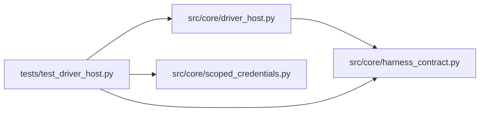

# test_driver_host Module

**Path:** `tests/test_driver_host.py`

## Description

Managed process-driver host: transport, supervision, and isolation.

The verification matrix: valid/malformed/oversized event streams, stalled
consumers, credential isolation, descendant cleanup, mid-event process
death, start deadlines, and the authority separation (driver proposals
are never verified results).

## Imports

| Source | Symbols |
|--------|---------|
| `__future__` | `annotations` |
| `json` | `json` |
| `os` | `os` |
| `pathlib` | `Path` |
| `pytest` | `pytest` |
| `src.core.driver_host` | `DRIVER_ENV_ALLOWLIST`, `DriverHost`, `DriverHostConfig` |
| `src.core.harness_contract` | `HARNESS_CONTRACT_VERSION` |
| `src.core.scoped_credentials` | `NON_GRANTABLE_PERMISSIONS`, `issue_scoped_credential`, `verify_scoped_credential` |
| `sys` | `sys` |
| `time` | `time` |

## Local dependency map

<!-- Auto-generated local dependency summary. Do not edit by hand. -->

### Internal neighbors

| Direction | Module |
|---|---|
| Outbound | [driver_host](../modules/driver_host.md) |
| Outbound | [harness_contract](../modules/harness_contract.md) |
| Outbound | [scoped_credentials](../modules/scoped_credentials.md) |

### External packages

| Language | Used packages | Undeclared packages |
|---|---:|---:|
| python | 1 | 1 |

## Functions

| Function | Signature | Decorators | Description |
|----------|-----------|------------|-------------|
| `_driver_script` | `(body: str) -> tuple[str, ...]` | — | — |
| `_config` | `(tmp_path, body, **overrides)` | — | — |
| `test_valid_stream_and_example_driver` | `(tmp_path)` | — | — |
| `test_malformed_stream_is_bounded` | `(tmp_path)` | — | — |
| `test_oversized_events_are_refused` | `(tmp_path)` | — | — |
| `test_stalled_consumer_backpressure_is_bounded` | `(tmp_path)` | — | — |
| `test_credential_isolation` | `(tmp_path, monkeypatch)` | — | — |
| `test_descendant_cleanup_kills_the_process_group` | `(tmp_path)` | — | — |
| `test_mid_event_process_death_is_attributed` | `(tmp_path)` | — | — |
| `test_start_deadline_times_out_with_cleanup` | `(tmp_path)` | — | — |
| `test_stderr_is_bounded_captured` | `(tmp_path)` | — | — |
