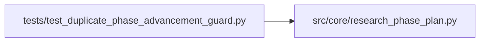

# test_duplicate_phase_advancement_guard Module

**Path:** `tests/test_duplicate_phase_advancement_guard.py`

## Description

Post-``res_99469dfc1088`` defense-in-depth — rejected-duplicate
iterations must not count toward phase advancement.

Live evidence: in session ``res_99469dfc1088`` (2026-05-20 21:55→22:59 UTC):
- iter 2 was ``rejected_duplicate`` in ``tabular_sweeps`` but carried a
  server-injected ``tabular_sweep_variant`` (Gap 1 regression, since
  patched at the orchestrator level). The phase plan still completed
  ``tabular_sweeps`` because ``_has_metric`` saw the marker key on the
  duplicate iter and the cardinality check counted it.
- iter 12 was ``rejected_duplicate`` in ``inference_parity_replay`` and
  contributed to satisfying Gap 2's floor=2, despite no training having
  run (only iter 11 was genuine).

The orchestrator-side Gap 1 patch closes the variant-injection path. This
file's tests verify the *phase-plan-side* defense: `_completed_phase_ids`
filters rejected-duplicate iters globally so the cardinality fallback and
any agent-emitted advancement key on a duplicate are both ignored.

## Imports

| Source | Symbols |
|--------|---------|
| `__future__` | `annotations` |
| `json` | `json` |
| `src.core.research_phase_plan` | `_completed_phase_ids` |

## Local dependency map

<!-- Auto-generated local dependency summary. Do not edit by hand. -->

### Internal neighbors

| Direction | Module |
|---|---|
| Outbound | [research_phase_plan](../modules/research_phase_plan.md) |

## Functions

| Function | Signature | Decorators | Description |
|----------|-----------|------------|-------------|
| `_iter` | `(*, iteration: int, search_phase: str, metrics: dict \| None = None, duplicate_reason: str \| None = None, config_snapshot: str \| None = None, decision: str = 'keep') -> dict` | — | — |
| `_baseline_iter` | `() -> dict` | — | A genuine baseline iter so `baseline_capture` is satisfied and the |
| `test_rejected_duplicate_with_advancement_key_does_not_complete_phase` | `() -> None` | — | The live `res_99469dfc1088` iter-2 scenario: a rejected-duplicate |
| `test_rejected_duplicate_does_not_count_toward_cardinality_floor` | `() -> None` | — | The live `res_99469dfc1088` iter-12 scenario: Gap 2's floor=2 for |
| `test_duplicate_iter_filtered_by_duplicate_reason_column` | `() -> None` | — | Defensive: the iteration row's `duplicate_reason` column alone is |
| `test_duplicate_iter_filtered_by_status_in_metrics_json` | `() -> None` | — | Defensive symmetry: metrics_json's `status: rejected_duplicate` is |
| `test_two_genuine_in_phase_iters_complete_phase_with_one_duplicate_present` | `() -> None` | — | The duplicate is filtered out, but the 2 genuine in-phase iters |
| `test_duplicate_does_not_block_baseline_capture` | `() -> None` | — | When the only iter is a rejected_duplicate, baseline_capture must |
