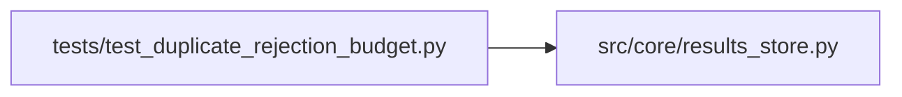

# test_duplicate_rejection_budget Module

**Path:** `tests/test_duplicate_rejection_budget.py`

## Description

Tests for duplicate-rejection budget decoupling.

A duplicate-rejected training attempt records an iteration row (for audit
and for the agent's anti-waste context digest), but it must NOT consume the
user-configured iteration budget (`config.max_iterations`). The orchestrator
tracks two counters:

  - `iteration_count`           — total record numbering (real + duplicates)
  - `duplicate_rejected_count`  — duplicates only

The effective iteration count = iteration_count - duplicate_rejected_count.
The budget check, agent-facing status message, phase continuation kick,
stagnation detector, and terminal_reason derivation all use the effective
count.

## Imports

| Source | Symbols |
|--------|---------|
| `__future__` | `annotations` |
| `pytest` | `pytest` |
| `src.core.results_store` | `_LATEST_SCHEMA_VERSION`, `ResultsStore` |

## Local dependency map

<!-- Auto-generated local dependency summary. Do not edit by hand. -->

### Internal neighbors

| Direction | Module |
|---|---|
| Outbound | [results_store](../modules/results_store.md) |

### External packages

| Language | Used packages | Undeclared packages |
|---|---:|---:|
| python | 1 | 1 |

## Functions

| Function | Signature | Decorators | Description |
|----------|-----------|------------|-------------|
| `test_latest_schema_version_includes_v4_migration` | `() -> None` | — | v4 introduces effective_iteration_count + terminate_request_* columns. |
| `test_session_persists_effective_iteration_count` | *(async)* `(tmp_path) -> None` | `@pytest.mark.asyncio` | update_session(effective_iteration_count=N) round-trips via get_session. |
| `test_session_persists_terminate_request_fields` | *(async)* `(tmp_path) -> None` | `@pytest.mark.asyncio` | update_session round-trips terminate_request_received + body. |
| `test_effective_iteration_count_defaults_to_zero` | *(async)* `(tmp_path) -> None` | `@pytest.mark.asyncio` | Fresh session has effective_iteration_count = 0. |
