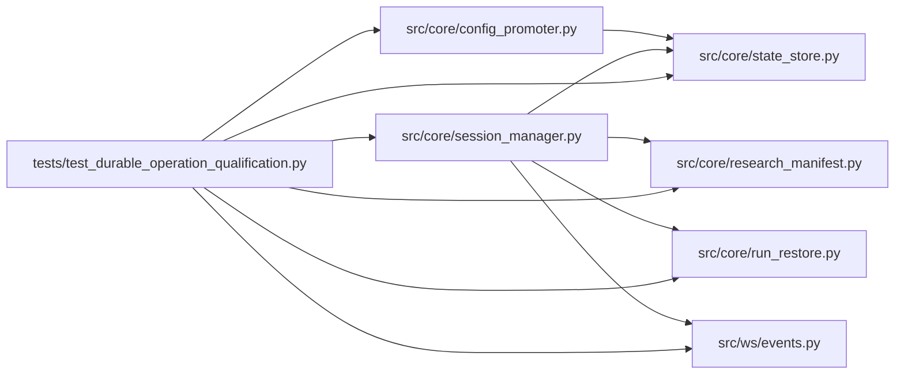

# test_durable_operation_qualification Module

**Path:** `tests/test_durable_operation_qualification.py`

## Description

Durable-operation qualification: fault injection with real process death.

Worker processes are killed (os._exit) at designated points during
bootstrap, evaluation, result acceptance, event publication, and promotion
intent handling. Persisted state is inspected after restart, recovery is
exercised and timed, and the qualified invariants hold: no duplicate
authoritative result/effect, no silent configuration drift, no shared
mutable workspace, and no stale-owner write. Unknown external effects are
exposed for reconciliation, never assumed absent.

## Imports

| Source | Symbols |
|--------|---------|
| `__future__` | `annotations` |
| `asyncio` | `asyncio` |
| `json` | `json` |
| `os` | `os` |
| `pathlib` | `Path` |
| `pytest` | `pytest` |
| `src.core.config_promoter` | `ConfigPromoter` |
| `src.core.research_manifest` | `load_persisted_manifest` |
| `src.core.run_restore` | `assess_recovery` |
| `src.core.session_manager` | `SessionManager` |
| `src.core.state_store` | `SQLiteStateStore`, `StaleFenceError` |
| `src.ws.events` | `relay_new_events` |
| `subprocess` | `subprocess` |
| `sys` | `sys` |
| `textwrap` | `textwrap` |
| `time` | `time` |

## Local dependency map

<!-- Auto-generated local dependency summary. Do not edit by hand. -->

### Internal neighbors

| Direction | Module |
|---|---|
| Outbound | [config_promoter](../modules/config_promoter.md) |
| Outbound | [research_manifest](../modules/research_manifest.md) |
| Outbound | [run_restore](../modules/run_restore.md) |
| Outbound | [session_manager](../modules/session_manager.md) |
| Outbound | [state_store](../modules/state_store.md) |
| Outbound | [events](../modules/events.md) |

### External packages

| Language | Used packages | Undeclared packages |
|---|---:|---:|
| python | 1 | 1 |

## Functions

| Function | Signature | Decorators | Description |
|----------|-----------|------------|-------------|
| `_open_store` | *(async)* `(tmp_path: Path) -> SQLiteStateStore` | — | — |
| `_kill_worker` | `(tmp_path: Path, phase: str) -> None` | — | — |
| `test_process_death_during_bootstrap_reconciles_cleanly` | *(async)* `(tmp_path)` | `@pytest.mark.asyncio` | — |
| `test_process_death_during_evaluation_exposes_unknown_inflight_state` | *(async)* `(tmp_path)` | `@pytest.mark.asyncio` | — |
| `test_process_death_during_result_acceptance_never_duplicates_results` | *(async)* `(tmp_path)` | `@pytest.mark.asyncio` | — |
| `test_process_death_during_event_publication_drops_no_event` | *(async)* `(tmp_path)` | `@pytest.mark.asyncio` | — |
| `test_process_death_during_promotion_intent_exposes_unknown_effect` | *(async)* `(tmp_path)` | `@pytest.mark.asyncio` | — |
| `test_stale_owner_write_is_refused_after_reclaim` | *(async)* `(tmp_path)` | `@pytest.mark.asyncio` | — |
| `_open_sessions` | *(async)* `(store: SQLiteStateStore) -> None` | — | — |
| `test_simultaneous_admission_and_resume_with_reservations` | `(tmp_path)` | — | Real workers race admission; a killed one resumes with its contract. |
