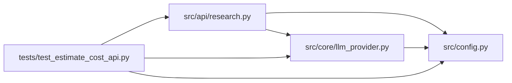

# test_estimate_cost_api Module

**Path:** `tests/test_estimate_cost_api.py`

## Description

POST /research/estimate-cost tests (P2 ops).

The endpoint replaces the UI's ``$0.24 × iterations`` heuristic with the
server-side estimator (``llm_provider.estimate_session_cost``) that shares
pricing with the post-call ledger. Pure compute — no store, no LLM.

## Imports

| Source | Symbols |
|--------|---------|
| `__future__` | `annotations` |
| `fastapi` | `FastAPI` |
| `fastapi.testclient` | `TestClient` |
| `os` | `os` |
| `pytest` | `pytest` |
| `src.api.research` | `router` |
| `src.config` | `settings` |
| `src.core.llm_provider` | `estimate_session_cost` |

## Local dependency map

<!-- Auto-generated local dependency summary. Do not edit by hand. -->

### Internal neighbors

| Direction | Module |
|---|---|
| Outbound | [research](../modules/research.md) |
| Outbound | [config](../modules/config.md) |
| Outbound | [llm_provider](../modules/llm_provider.md) |

### External packages

| Language | Used packages | Undeclared packages |
|---|---:|---:|
| python | 2 | 2 |

## Functions

| Function | Signature | Decorators | Description |
|----------|-----------|------------|-------------|
| `configure_auth` | `(monkeypatch: pytest.MonkeyPatch)` | `@pytest.fixture(autouse=True)` | — |
| `client` | `() -> TestClient` | `@pytest.fixture` | — |
| `_auth` | `() -> dict[str, str]` | — | — |
| `test_estimate_matches_shared_estimator` | `(client: TestClient)` | — | — |
| `test_estimate_reports_budget_cap` | `(client: TestClient)` | — | — |
| `test_quick_mode_is_cheaper` | `(client: TestClient)` | — | — |
| `test_estimate_requires_auth` | `(client: TestClient)` | — | — |
| `test_estimate_rejects_out_of_range` | `(client: TestClient)` | — | — |
