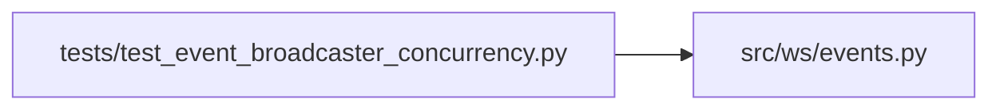

# test_event_broadcaster_concurrency Module

**Path:** `tests/test_event_broadcaster_concurrency.py`

## Description

P0-014 — EventBroadcaster concurrency stress tests.

The backlog names this file explicitly (``ARC-011-backlog.md`` §3, task
P0-014). The existing broadcaster coverage in ``test_hardening_phase1_to_5.py``
uses a ``_FakeWS`` whose ``send_text`` has no suspension point, so
``asyncio.gather`` does not produce real interleaving — it cannot catch a
regression if the snapshot-before-iterate hardening were removed. These tests
use fake sockets that ``await asyncio.sleep(0)`` (or longer) inside
``send_text`` so the event loop interleaves broadcast, connect, and disconnect
for real.

Also covers the P0-013 per-send timeout (``_BROADCAST_SEND_TIMEOUT_S``): a
stuck client must not stall the fan-out indefinitely.

## Imports

| Source | Symbols |
|--------|---------|
| `__future__` | `annotations` |
| `asyncio` | `asyncio` |
| `pytest` | `pytest` |
| `src.ws` | `events` |
| `src.ws.events` | `EventBroadcaster` |
| `time` | `time` |

## Local dependency map

<!-- Auto-generated local dependency summary. Do not edit by hand. -->

### Internal neighbors

| Direction | Module |
|---|---|
| Outbound | [events](../modules/events.md) |

### External packages

| Language | Used packages | Undeclared packages |
|---|---:|---:|
| python | 1 | 1 |

## Classes

| Class | Line | Bases | Description |
|-------|------|-------|-------------|
| [_YieldingFakeWS](../entities/YieldingFakeWS.md) | 27 | — | A fake WebSocket that yields to the event loop inside ``send_text``. |
| [_SlowFakeWS](../entities/SlowFakeWS.md) | 56 | — | A fake WebSocket whose ``send_text`` blocks past the send timeout. |

## Functions

| Function | Signature | Decorators | Description |
|----------|-----------|------------|-------------|
| `test_concurrent_broadcast_and_disconnect_never_raises` | *(async)* `() -> None` | `@pytest.mark.asyncio` | — |
| `test_connect_during_broadcast_is_safe` | *(async)* `() -> None` | `@pytest.mark.asyncio` | — |
| `test_broadcast_storm_with_churn` | *(async)* `() -> None` | `@pytest.mark.asyncio` | — |
| `test_dead_client_pruned_exactly` | *(async)* `() -> None` | `@pytest.mark.asyncio` | — |
| `test_slow_client_does_not_block_broadcast` | *(async)* `(monkeypatch) -> None` | `@pytest.mark.asyncio` | A stuck/half-open WebSocket is pruned after the send timeout, not held |
