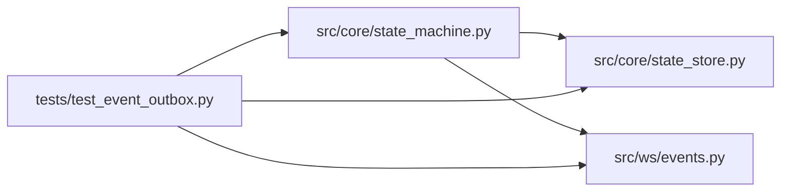

# test_event_outbox Module

**Path:** `tests/test_event_outbox.py`

## Description

Transactional event outbox: cross-worker delivery, replay, and resync.

Committed state transitions publish durable, correlated events in the same
transaction; clients catch up through bounded cursor reads; duplicates and
out-of-order deliveries apply at most once; expired cursors resynchronize
from an atomic snapshot-plus-cursor.

## Imports

| Source | Symbols |
|--------|---------|
| `__future__` | `annotations` |
| `pathlib` | `Path` |
| `pytest` | `pytest` |
| `src.core.state_machine` | `SessionEvent`, `SessionStateMachine` |
| `src.core.state_store` | `SQLiteStateStore` |
| `src.ws.events` | `dedupe_events`, `plan_catchup`, `poll_events`, `redact_event_payload`, `relay_new_events`, `snapshot_with_cursor` |

## Local dependency map

<!-- Auto-generated local dependency summary. Do not edit by hand. -->

### Internal neighbors

| Direction | Module |
|---|---|
| Outbound | [state_machine](../modules/state_machine.md) |
| Outbound | [state_store](../modules/state_store.md) |
| Outbound | [events](../modules/events.md) |

### External packages

| Language | Used packages | Undeclared packages |
|---|---:|---:|
| python | 1 | 1 |

## Functions

| Function | Signature | Decorators | Description |
|----------|-----------|------------|-------------|
| `_open_store` | *(async)* `(tmp_path: Path) -> SQLiteStateStore` | — | — |
| `_seed_session` | *(async)* `(store: SQLiteStateStore, session_id: str) -> dict` | — | — |
| `test_events_are_correlated_versioned_and_cursor_ordered` | *(async)* `(tmp_path)` | `@pytest.mark.asyncio` | — |
| `test_append_is_idempotent_and_duplicates_apply_once` | *(async)* `(tmp_path)` | `@pytest.mark.asyncio` | — |
| `test_out_of_order_delivery_is_reordered_by_sequence` | *(async)* `(tmp_path)` | `@pytest.mark.asyncio` | — |
| `test_state_and_event_publication_commit_together` | *(async)* `(tmp_path)` | `@pytest.mark.asyncio` | — |
| `test_producer_payloads_are_versioned` | *(async)* `(tmp_path)` | `@pytest.mark.asyncio` | — |
| `test_reconnect_catchup_is_bounded_for_slow_consumers` | *(async)* `(tmp_path)` | `@pytest.mark.asyncio` | — |
| `test_expired_cursor_requires_snapshot_plus_cursor_resync` | *(async)* `(tmp_path)` | `@pytest.mark.asyncio` | — |
| `test_redaction_strips_secrets_before_publication` | `()` | — | — |
| `test_two_worker_fanout_and_relay_catchup` | *(async)* `(tmp_path)` | `@pytest.mark.asyncio` | A client on worker B observes runs produced on worker A. |
