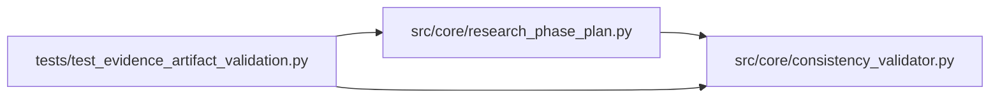

# test_evidence_artifact_validation Module

**Path:** `tests/test_evidence_artifact_validation.py`

## Description

AR-5: Tests for artifact-bound evidence-key validation for promotion-family phases.

Defect D3 (part 1): ``_completed_phase_ids`` in ``research_phase_plan.py``
marked phases like ``multi_seed_robustness`` and ``inference_parity_replay``
complete purely on the presence of an evidence key in ``metrics_json`` — WITHOUT
verifying that the evidence actually pointed to real, distinct artifacts. This
allowed the LLM to "advance" phases by emitting:

  * ``seed_trials`` entries that all share the same ``mlflow_run_id``,
  * ``inference_parity`` payload whose ``mlflow_run_id`` is identical to a
    prior training iteration's run_id, or
  * ``calibration_full_validation`` without a ``selected.run_id`` or
    ``economic_replay.gates`` dict.

Fix (two-part):

1. New function ``check_evidence_artifact(metrics, phase_id, *, prior_run_ids)``
   in ``consistency_validator.py`` performs the artifact validation check and
   returns the blocker string ``"evidence_artifact_missing_for_<phase_id>"`` on
   failure (or ``None`` on success).

2. ``_completed_phase_ids`` in ``research_phase_plan.py`` gates each
   promotion-family phase evidence-key acceptance behind
   ``check_evidence_artifact``.  A phase is only marked complete when BOTH the
   evidence key IS present AND the artifact check PASSES.

## Imports

| Source | Symbols |
|--------|---------|
| `__future__` | `annotations` |
| `json` | `json` |
| `pytest` | `pytest` |
| `src.core.consistency_validator` | `EVIDENCE_ARTIFACT_PHASES`, `check_adaptive_feature_sweep`, `check_evidence_artifact`, `_is_synthetic_promotion_iteration` |
| `src.core.research_phase_plan` | `build_phase_state`, `_prior_best_metrics` |

## Local dependency map

<!-- Auto-generated local dependency summary. Do not edit by hand. -->

### Internal neighbors

| Direction | Module |
|---|---|
| Outbound | [consistency_validator](../modules/consistency_validator.md) |
| Outbound | [research_phase_plan](../modules/research_phase_plan.md) |

### External packages

| Language | Used packages | Undeclared packages |
|---|---:|---:|
| python | 1 | 1 |

## Functions

| Function | Signature | Decorators | Description |
|----------|-----------|------------|-------------|
| `_make_seed_trial` | `(run_id: str) -> dict` | — | — |
| `_seed_trials_metrics` | `(run_ids: list[str], n_seed_trials: int \| None = None) -> dict` | — | Build a metrics dict that carries a ``seed_trials`` list. |
| `_inference_parity_metrics` | `(run_id: str, feature_count_alignment_passed: bool = True) -> dict` | — | — |
| `_calibration_gates_metrics` | `(*, selected_run_id: str \| None, has_gates: bool) -> dict` | — | — |
| `_iteration_row` | `(*, iteration: int, metrics: dict, search_phase: str \| None = None, mlflow_run_id: str \| None = None) -> dict` | — | Minimal iteration row shape matching what the ResultsStore returns. |
| `test_evidence_artifact_check_passes_for_real_seed_trials` | `() -> None` | — | AR-5: 5 seed_trials with distinct mlflow_run_ids → None (pass). |
| `test_evidence_artifact_check_blocks_synthetic_seed_trials` | `() -> None` | — | AR-5: 5 seed_trials but all share the same mlflow_run_id → blocker. |
| `test_evidence_artifact_check_blocks_when_seed_trials_too_few` | `() -> None` | — | Fewer seed_trial entries than n_seed_trials → blocker. |
| `test_evidence_artifact_check_blocks_when_seed_trials_missing` | `() -> None` | — | No seed_trials key at all → blocker. |
| `test_evidence_artifact_check_default_n_required_is_two` | `() -> None` | — | When n_seed_trials is absent, default minimum is 2 unique ids. |
| `test_evidence_artifact_check_accepts_artifact_hash_in_seed_trials` | `() -> None` | — | artifact_hash is an acceptable substitute for mlflow_run_id. |
| `test_evidence_artifact_force_evidence_acceptance_bypasses_check` | `() -> None` | — | force_evidence_acceptance: True skips validation with a warning. |
| `test_evidence_artifact_check_passes_for_inference_parity_with_new_run` | `() -> None` | — | AR-5: inference_parity with feature_count_alignment_passed + new run_id → pass. |
| `test_evidence_artifact_check_blocks_inference_parity_when_run_id_unchanged` | `() -> None` | — | AR-5: inference_parity with same run_id as a prior training run → blocker. |
| `test_evidence_artifact_check_blocks_inference_parity_when_feature_check_failed` | `() -> None` | — | feature_count_alignment_passed=False → blocker regardless of run_id. |
| `test_evidence_artifact_check_blocks_inference_parity_when_parity_missing` | `() -> None` | — | No inference_parity key at all → blocker. |
| `test_evidence_artifact_check_skips_run_id_comparison_when_prior_not_provided` | `() -> None` | — | When prior_run_ids is not passed, the run_id uniqueness check is skipped. |
| `test_evidence_artifact_check_passes_for_valid_calibration_gates` | `() -> None` | — | selected.run_id present AND economic_replay.gates dict present → pass. |
| `test_evidence_artifact_check_blocks_calibration_when_run_id_missing` | `() -> None` | — | calibration_full_validation.selected.run_id is None → blocker. |
| `test_evidence_artifact_check_blocks_calibration_when_gates_missing` | `() -> None` | — | economic_replay.gates dict absent → blocker. |
| `test_evidence_artifact_check_returns_none_for_non_scoped_phase` | `() -> None` | — | Phases not in EVIDENCE_ARTIFACT_PHASES return None unconditionally. |
| `test_evidence_artifact_phases_constant_covers_expected_phases` | `() -> None` | — | EVIDENCE_ARTIFACT_PHASES must cover all promotion-family phases. |
| `_session_row` | `(model_type: str = 'direction') -> dict` | — | — |
| `_all_prior_phases_completed_iters` | `() -> list` | — | Realistic prior iterations that mark baseline_capture+tabular_sweeps done. |
| `test_phase_not_marked_complete_when_evidence_artifact_blocker_active` | `() -> None` | — | AR-5 core: multi_seed_robustness NOT completed when seed_trials are synthetic. |
| `test_phase_marked_complete_when_real_seed_trials_present` | `() -> None` | — | Multi-seed phase advances when ≥3 in-phase iters carry distinct |
| `_adaptive_prior_iters` | `() -> list` | — | Prior direction iterations that stop at the adaptive sweep phase. |
| `test_adaptive_phase_not_completed_when_requested_flag_not_active` | `() -> None` | — | — |
| `test_adaptive_feature_sweep_check_blocks_requested_but_inactive` | `() -> None` | — | — |
| `test_adaptive_phase_completed_when_active_features_change_schema` | `() -> None` | — | — |
| `test_adaptive_phase_accepts_explicit_non_bug_noop_reason` | `() -> None` | — | — |
| `test_adaptive_phase_not_completed_on_version_only_evidence` | `() -> None` | — | — |
| `test_inference_parity_not_completed_when_run_id_from_prior_phase` | `() -> None` | — | Inference parity phase not completed when run_id matches a training iteration. |
| `test_synthetic_promotion_iteration_blocked` | `() -> None` | — | AR-6: training_time_s=None + metric matches prior + no new run_id → blocker. |
| `test_synthetic_check_allows_real_promotion_metadata` | `() -> None` | — | AR-6: server-owned promotion finalisation is NOT synthetic. |
| `test_synthetic_check_not_triggered_when_training_time_present` | `() -> None` | — | AR-6: when training_time_s is non-None, never synthetic (condition 1 fails). |
| `test_synthetic_check_not_triggered_when_metric_changed` | `() -> None` | — | AR-6: improved metric breaks condition 2 → not synthetic. |
| `test_synthetic_check_not_triggered_when_metric_within_4dp_tolerance` | `() -> None` | — | AR-6: 0.63940001 rounds to same 4dp as 0.6394 → still synthetic. |
| `test_synthetic_check_not_triggered_when_new_run_id` | `() -> None` | — | AR-6: a distinct mlflow_run_id breaks condition 3 → not synthetic. |
| `test_synthetic_check_not_triggered_when_prior_best_empty` | `() -> None` | — | AR-6: empty prior_best dict disables comparison conservatively (no block). |
| `test_synthetic_check_promotion_proposal_blocked_without_promotion_metadata` | `() -> None` | — | AR-6: promotion_proposal iteration without decision/rollback_target is synthetic. |
| `test_prior_best_metrics_returns_best_non_promotion_family` | `() -> None` | — | _prior_best_metrics returns the highest training-phase metric. |
| `test_prior_best_metrics_ignores_later_worse_non_promotion_family` | `() -> None` | — | A later worse row must not hide the true prior best. |
| `test_synthetic_check_blocks_copy_of_true_best_after_later_worse_row` | `() -> None` | — | Synthetic detection compares against the true prior best, not latest row. |
| `test_prior_best_metrics_returns_empty_when_no_qualifying_iteration` | `() -> None` | — | _prior_best_metrics returns {} when all iterations are promotion-family. |
| `test_multi_seed_phase_not_advanced_when_all_iterations_are_synthetic` | `() -> None` | — | AR-6 core: multi_seed_robustness stays incomplete when all seed iters are synthetic. |
| `test_multi_seed_phase_advances_when_iteration_has_training_time` | `() -> None` | — | AR-6: multi_seed_robustness advances when training_time_s is present |
