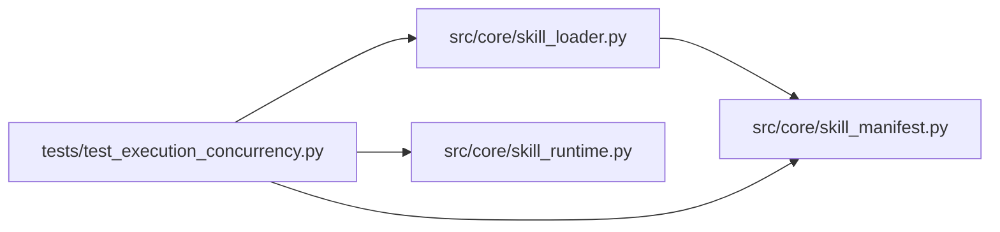

# test_execution_concurrency Module

**Path:** `tests/test_execution_concurrency.py`

## Description

Execution-config plumbing tests (P1-4).

``execution.concurrency`` (1..3, default 1) declares a skill's parallel-trial
opt-in. Default preserves the strictly-sequential loop byte-for-byte; the
orchestrator-side parallel dispatch is staged behind this field.

## Imports

| Source | Symbols |
|--------|---------|
| `__future__` | `annotations` |
| `os` | `os` |
| `pathlib` | `Path` |
| `pydantic` | `ValidationError`, `ValidationError` |
| `pytest` | `pytest` |
| `src.core.skill_loader` | `load_skill_manifest` |
| `src.core.skill_manifest` | `ExecutionConfig` |
| `src.core.skill_runtime` | `ManifestSkillRuntime` |
| `unittest.mock` | `MagicMock` |
| `yaml` | `yaml` |

## Local dependency map

<!-- Auto-generated local dependency summary. Do not edit by hand. -->

### Internal neighbors

| Direction | Module |
|---|---|
| Outbound | [skill_loader](../modules/skill_loader.md) |
| Outbound | [skill_manifest](../modules/skill_manifest.md) |
| Outbound | [skill_runtime](../modules/skill_runtime.md) |

### External packages

| Language | Used packages | Undeclared packages |
|---|---:|---:|
| python | 3 | 1 |

## Functions

| Function | Signature | Decorators | Description |
|----------|-----------|------------|-------------|
| `_runtime_for` | `(primary_overrides: dict \| None = None, execution = None)` | — | — |
| `test_manifest_without_execution_defaults_to_sequential` | `()` | — | — |
| `test_manifest_execution_concurrency_opt_in` | `()` | — | — |
| `test_execution_concurrency_bounds_enforced` | `()` | — | — |
| `test_execution_rejects_unknown_keys` | `()` | — | — |
