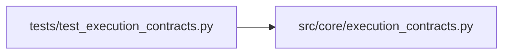

# test_execution_contracts Module

**Path:** `tests/test_execution_contracts.py`

## Description

Tests for the versioned research and execution contracts.

Fixture payloads use synthetic identifiers and digest strings only.

## Imports

| Source | Symbols |
|--------|---------|
| `__future__` | `annotations` |
| `ast` | `ast` |
| `pathlib` | `Path` |
| `pydantic` | `ValidationError` |
| `pytest` | `pytest` |
| `src.core` | `execution_contracts` |
| `typing` | `Any`, `Optional` |

## Local dependency map

<!-- Auto-generated local dependency summary. Do not edit by hand. -->

### Internal neighbors

| Direction | Module |
|---|---|
| Outbound | [execution_contracts](../modules/execution_contracts.md) |

### External packages

| Language | Used packages | Undeclared packages |
|---|---:|---:|
| python | 2 | 1 |

## Functions

| Function | Signature | Decorators | Description |
|----------|-----------|------------|-------------|
| `_candidate` | `(candidate_id: str = 'cand-1', digest: str = DIGEST_A) -> ec.CandidateIdentity` | — | — |
| `_observation` | `(candidate_digest: str = DIGEST_A, *, fidelity: str = 'measured', observation_id: str = 'obs-1') -> ec.ObservationIdentity` | — | — |
| `_receipt` | `() -> ec.ResultReceipt` | — | — |
| `_capabilities` | `(*, integration: str = 'managed', extra: Optional[list[str]] = None) -> ec.CapabilityDescriptor` | — | — |
| `_objective` | `(direction: str = 'maximize') -> ec.ObjectivePolicy` | — | — |
| `_run_spec` | `(**overrides: Any) -> ec.RunSpec` | — | — |
| `_execution_request` | `(**overrides: Any) -> ec.ExecutionRequest` | — | — |
| `_verified_result` | `(**overrides: Any) -> ec.VerifiedResult` | — | — |
| `test_contract_versions_are_unique` | `() -> None` | — | — |
| `test_run_spec_rejects_unknown_schema_version` | `() -> None` | — | — |
| `test_every_top_level_contract_rejects_unknown_version` | `() -> None` | — | — |
| `test_run_spec_json_round_trip` | `() -> None` | — | — |
| `test_execution_request_json_round_trip` | `() -> None` | — | — |
| `test_verified_result_json_round_trip` | `() -> None` | — | — |
| `test_secret_reference_wire_form_round_trip` | `() -> None` | — | — |
| `test_secret_reference_rejects_invalid_names` | `() -> None` | — | — |
| `test_run_spec_rejects_raw_credential_parameters` | `() -> None` | — | — |
| `test_run_spec_accepts_secret_reference_parameters` | `() -> None` | — | — |
| `test_plain_parameter_names_are_not_flagged_as_secrets` | `() -> None` | — | — |
| `test_attached_run_rejects_operator_and_approver_credentials` | `() -> None` | — | — |
| `test_attached_run_accepts_scoped_harness_credentials` | `() -> None` | — | — |
| `test_duplicate_secret_references_rejected` | `() -> None` | — | — |
| `test_run_spec_rejects_inline_mutable_candidate_data` | `() -> None` | — | — |
| `test_candidate_data_identity_is_order_independent` | `() -> None` | — | — |
| `test_digest_shape_is_enforced` | `() -> None` | — | — |
| `test_observation_context_digest_separates_fidelity` | `() -> None` | — | — |
| `test_objective_policy_maps_skill_metric_vocabulary` | `() -> None` | — | — |
| `test_objective_policy_rejects_nonfinite_threshold` | `() -> None` | — | — |
| `test_capability_descriptor_rejects_unknown_identifiers` | `() -> None` | — | — |
| `test_capability_descriptor_rejects_claimed_and_unsupported_overlap` | `() -> None` | — | — |
| `test_minimum_capabilities_pass_and_fail` | `() -> None` | — | — |
| `test_capabilities_outside_operator_allowance_rejected` | `() -> None` | — | — |
| `test_qualified_isolation_boundary_accepted` | `() -> None` | — | — |
| `test_application_only_isolation_rejected` | `() -> None` | — | — |
| `test_missing_resource_limits_rejected` | `() -> None` | — | — |
| `test_succeeded_result_requires_metrics` | `() -> None` | — | — |
| `test_failed_result_must_not_claim_metrics` | `() -> None` | — | — |
| `test_non_succeeded_result_requires_failure_record` | `() -> None` | — | — |
| `test_nonfinite_metrics_rejected` | `() -> None` | — | — |
| `test_imported_results_stay_unverified` | `() -> None` | — | — |
| `test_evaluator_owned_results_are_verified_by_construction` | `() -> None` | — | — |
| `test_network_deny_rejects_allowed_hosts` | `() -> None` | — | — |
| `test_execution_request_rejects_bad_digest_shapes` | `() -> None` | — | — |
| `test_request_run_spec_binding_accepts_exact_match` | `() -> None` | — | — |
| `test_request_run_spec_binding_rejects_mismatches` | `(override: dict) -> None` | `@pytest.mark.parametrize('override', [{'run_spec_digest': DIGEST_B}, {'run_id': 'run-other'}, {'evaluator_digest': DIGEST_D}, {'dataset_digests': [DIGEST_C]}, {'environment_digest': DIGEST_C}, {'integration': 'attached'}])` | — |
| `_resolve` | `(**kwargs: Any) -> ec.ResolvedRunInputs` | — | — |
| `test_precedence_chain_for_budget_fields` | `() -> None` | — | — |
| `test_operator_constraints_bound_explicit_inputs` | `() -> None` | — | — |
| `test_harness_preferences_cannot_widen_authority` | `() -> None` | — | — |
| `test_harness_preferences_never_set_domain_parameters` | `() -> None` | — | — |
| `test_explicit_parameters_override_skill_defaults` | `() -> None` | — | — |
| `test_model_roles_prefer_skill_defaults_over_preferences` | `() -> None` | — | — |
| `test_budget_fields_never_leak_into_parameters` | `() -> None` | — | — |
| `test_resolve_rejects_negative_spend_request` | `() -> None` | — | — |
| `test_resolve_rejects_raw_secret_values` | `() -> None` | — | — |
| `_legacy_manifest` | `(**overrides: Any) -> dict[str, Any]` | — | — |
| `test_legacy_manifest_maps_preserved_fields` | `() -> None` | — | — |
| `test_legacy_reader_accepts_v1_and_v3_and_rejects_unknown` | `() -> None` | — | — |
| `test_legacy_reader_rejects_requested_incomplete_features` | `() -> None` | — | — |
| `test_legacy_reader_tolerates_absent_rejected_fields` | `() -> None` | — | — |
| `test_legacy_reader_never_invents_a_budget` | `() -> None` | — | — |
| `test_legacy_reader_rejects_raw_secret_parameters` | `() -> None` | — | — |
| `test_legacy_start_request_converts_minutes_and_defaults` | `() -> None` | — | — |
| `test_legacy_session_manifest_preserves_focus_hint` | `() -> None` | — | — |
| `test_compatibility_mapping_distinguishes_preserved_and_rejected` | `() -> None` | — | — |
| `test_kernel_contract_module_imports_no_harness_sdks` | `() -> None` | — | — |
