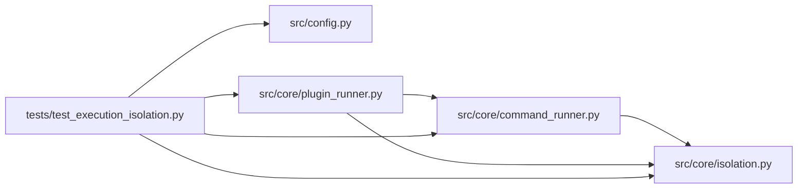

# test_execution_isolation Module

**Path:** `tests/test_execution_isolation.py`

## Description

Execution isolation acceptance tests.

Real filesystem/network denial probes, child-process containment, capability
refusal, host-prerequisite failure behavior, and trusted/untrusted mode
contract tests. The probes are gated on the host actually providing the
isolation prerequisites (bubblewrap + user namespaces); the contract tests
are host-independent.

## Imports

| Source | Symbols |
|--------|---------|
| `__future__` | `annotations` |
| `asyncio` | `asyncio`, `asyncio`, `asyncio`, `asyncio` |
| `dataclasses` | `replace` |
| `hashlib` | `hashlib` |
| `json` | `json` |
| `pathlib` | `Path` |
| `pytest` | `pytest` |
| `src.config` | `get_settings` |
| `src.core.command_runner` | `GovernedCommandRunner`, `GovernedCommandRunner`, `GovernedCommandRunner` |
| `src.core.isolation` | `SANDBOXED_PREFIX`, `TRUSTED_LOCAL_CODE`, `BwrapBackend`, `IsolationPolicy`, `IsolationUnavailableError`, `UnsupportedCapabilityError`, `probe_host`, `wrap_command` |
| `src.core.plugin_runner` | `PluginCaps`, `PluginRunner` |
| `subprocess` | `subprocess` |
| `sys` | `sys` |

## Local dependency map

<!-- Auto-generated local dependency summary. Do not edit by hand. -->

### Internal neighbors

| Direction | Module |
|---|---|
| Outbound | [config](../modules/config.md) |
| Outbound | [command_runner](../modules/command_runner.md) |
| Outbound | [isolation](../modules/isolation.md) |
| Outbound | [plugin_runner](../modules/plugin_runner.md) |

### External packages

| Language | Used packages | Undeclared packages |
|---|---:|---:|
| python | 1 | 1 |

## Functions

| Function | Signature | Decorators | Description |
|----------|-----------|------------|-------------|
| `_run_sandboxed` | `(policy: IsolationPolicy, script: str) -> str` | — | — |
| `_probe_script` | `(*attempts: str) -> str` | — | A python probe that runs each attempt and reports success/failure. |
| `test_fs_write_none_denied_at_os_boundary` | `(tmp_path: Path) -> None` | `@requires_backend` | ``fs_write: none`` prevents writes at the OS boundary. |
| `test_fs_write_workspace_confined` | `(tmp_path: Path) -> None` | `@requires_backend` | ``fs_write: workspace`` permits workspace writes and nothing else. |
| `test_network_default_deny` | `() -> None` | `@requires_backend` | Disallowed network destinations are unreachable (default-deny). |
| `test_child_process_attempts_cannot_escape` | `(tmp_path: Path) -> None` | `@requires_backend` | Candidate-controlled subprocesses cannot escape the same policy. |
| `test_network_allowlist_capability_refused` | `() -> None` | — | Unsupported capability requests are refused, never silently widened. |
| `test_masked_evaluator_code_unreadable` | `(tmp_path: Path) -> None` | `@requires_backend` | Plugins are isolated from evaluator code via masked mounts. |
| `_write_probe_plugin` | `(skill_dir: Path, *, attempt: str) -> None` | — | — |
| `test_plugin_runner_enforced_mode_sandboxed` | `(tmp_path: Path) -> None` | `@requires_backend` | Untrusted plugin runs are sandboxed: caps enforced at the OS boundary. |
| `test_plugin_runner_refuses_allowlist_request` | `(tmp_path: Path) -> None` | `@requires_backend` | A plugin requesting network egress is refused and never executes. |
| `test_plugin_runner_host_prereq_failure_fails_closed` | `(tmp_path: Path, monkeypatch: pytest.MonkeyPatch) -> None` | — | Unavailable isolation refuses execution instead of falling back. |
| `test_trusted_local_code_mode_labeled_not_sandboxed` | `(tmp_path: Path, monkeypatch: pytest.MonkeyPatch) -> None` | — | The trusted local-code policy is separately labeled, never sandboxed. |
| `_cmd_fixture` | `(tmp_path: Path)` | — | Workspace/session + a pinned evaluator, mirroring the resolver tests. |
| `test_command_runner_trusted_boundary_labeled` | `(tmp_path: Path) -> None` | — | Without an isolation policy the command path is labeled local-code. |
| `test_command_runner_sandboxed_enforces_policy` | `(tmp_path: Path) -> None` | `@requires_backend` | With an isolation policy the same boundary confines governed commands. |
| `test_command_runner_refuses_unenforceable_policy` | `(tmp_path: Path) -> None` | — | An unenforceable capability refuses the execution (no silent fallback). |
