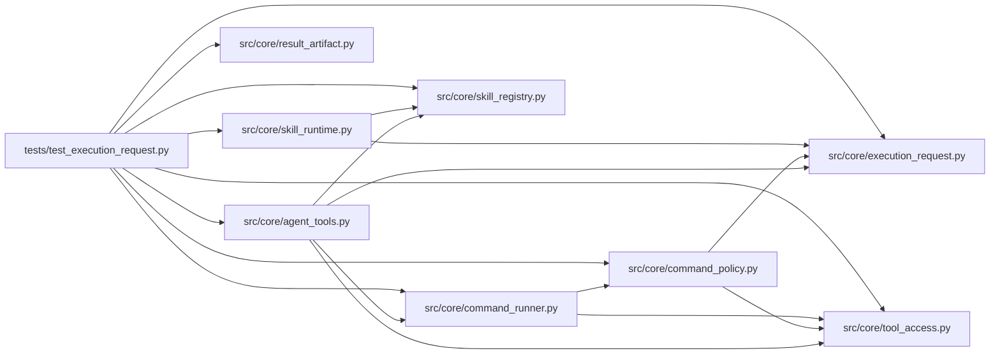

# test_execution_request Module

**Path:** `tests/test_execution_request.py`

## Description

One resolved execution request: policy/process parity regressions.

The execution request contract (F06): executable, typed argv, fixed
arguments, CWD, inputs, outputs, and timeout resolve once into one
immutable request that authorization, pre-run snapshots, sequential and
parallel execution, and result lookup all consume. Live and demo templates
route through the same resolver; shell-dependent templates and unsupported
executable bindings are rejected with migration diagnostics.

## Imports

| Source | Symbols |
|--------|---------|
| `__future__` | `annotations` |
| `hashlib` | `hashlib` |
| `json` | `json` |
| `pathlib` | `Path` |
| `pytest` | `pytest` |
| `shutil` | `shutil` |
| `src.core.agent_tools` | `_config_snapshot_path_from_command`, `_execute_tool` |
| `src.core.command_policy` | `evaluate_command_policy` |
| `src.core.command_runner` | `GovernedCommandRunner` |
| `src.core.execution_request` | `resolve_execution_request`, `template_migration_reason` |
| `src.core.result_artifact` | `enrich_marker_from_result_artifact` |
| `src.core.skill_registry` | `SkillRegistry` |
| `src.core.skill_runtime` | `ManifestSkillRuntime`, `SkillConfigError` |
| `src.core.tool_access` | `build_tool_access_context` |
| `subprocess` | `subprocess` |
| `sys` | `sys` |
| `yaml` | `yaml` |

## Local dependency map

<!-- Auto-generated local dependency summary. Do not edit by hand. -->

### Internal neighbors

| Direction | Module |
|---|---|
| Outbound | [agent_tools](../modules/agent_tools.md) |
| Outbound | [command_policy](../modules/command_policy.md) |
| Outbound | [command_runner](../modules/command_runner.md) |
| Outbound | [execution_request](../modules/execution_request.md) |
| Outbound | [result_artifact](../modules/result_artifact.md) |
| Outbound | [skill_registry](../modules/skill_registry.md) |
| Outbound | [skill_runtime](../modules/skill_runtime.md) |
| Outbound | [tool_access](../modules/tool_access.md) |

### External packages

| Language | Used packages | Undeclared packages |
|---|---:|---:|
| python | 2 | 1 |

## Functions

| Function | Signature | Decorators | Description |
|----------|-----------|------------|-------------|
| `_workspace` | `(tmp_path: Path) -> tuple[str, str]` | — | — |
| `_pin` | `(tmp_path: Path, content: str = EVAL_CONTENT) -> dict` | — | — |
| `test_live_template_with_bare_config_path_executes_end_to_end` | `(tmp_path: Path)` | — | F06 reproduction: the declared live experiment command (bare config |
| `_resolve` | `(command: str, workspace: str, session: str, extension: dict, workdir = None)` | — | — |
| `test_absolute_and_relative_inputs_resolve_to_one_path` | `(tmp_path: Path)` | — | — |
| `test_paths_with_spaces_resolve_as_single_arguments` | `(tmp_path: Path)` | — | — |
| `test_duplicate_flags_cannot_override_a_validated_argument` | `(tmp_path: Path)` | — | — |
| `test_equals_spelling_faces_identical_validation` | `(tmp_path: Path)` | — | — |
| `test_policy_and_process_observe_the_same_arguments` | `(tmp_path: Path)` | — | — |
| `test_relative_outputs_land_in_the_attempt_output_root` | `(tmp_path: Path)` | — | — |
| `test_sequential_and_parallel_requests_stay_at_parity` | `(tmp_path: Path)` | — | — |
| `test_shell_dependent_templates_are_rejected_with_migration_diagnostics` | `()` | — | — |
| `test_template_shape_is_enforced_at_run_start` | `(tmp_path: Path)` | — | — |
| `test_unsupported_executable_bindings_are_rejected` | `(tmp_path: Path)` | — | — |
| `test_python_bindings_must_be_explicitly_qualified` | `(tmp_path: Path)` | — | — |
| `test_bundled_skills_advertise_only_supported_bindings` | `()` | — | — |
| `test_result_ingestion_prefers_the_attempt_output_root` | `(tmp_path: Path)` | — | — |
| `test_pre_run_snapshot_and_request_agree_on_the_config_path` | `(tmp_path: Path)` | — | — |
| `test_pinned_interpreter_binding_keeps_workspace_venv` | `(tmp_path: Path)` | — | The pinned interpreter reaches argv as the workspace-venv binding. |
