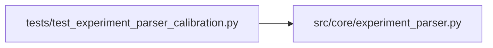

# test_experiment_parser_calibration Module

**Path:** `tests/test_experiment_parser_calibration.py`

## Description

Tests for experiment_parser _json suffix handling for phase 5 evidence keys.

Verifies that calibration_full_validation_json and economic_replay_json emitted
by prepare.py are parsed into dict-valued extras by parse_prepare_output(), so
that _has_metric() and check_evidence_artifact() can advance calibration_replay_gates.

## Imports

| Source | Symbols |
|--------|---------|
| `__future__` | `annotations` |
| `json` | `json` |
| `src.core.experiment_parser` | `parse_prepare_output` |

## Local dependency map

<!-- Auto-generated local dependency summary. Do not edit by hand. -->

### Internal neighbors

| Direction | Module |
|---|---|
| Outbound | [experiment_parser](../modules/experiment_parser.md) |

## Functions

| Function | Signature | Decorators | Description |
|----------|-----------|------------|-------------|
| `_block` | `(extra_lines: str = '') -> str` | — | — |
| `test_calibration_full_validation_json_parsed_as_dict` | `() -> None` | — | — |
| `test_economic_replay_json_parsed_as_dict` | `() -> None` | — | — |
| `test_both_keys_appear_in_to_dict` | `() -> None` | — | — |
| `test_missing_calibration_keys_produce_no_extra` | `() -> None` | — | — |
| `test_json_suffix_also_stores_raw_key` | `() -> None` | — | — |
