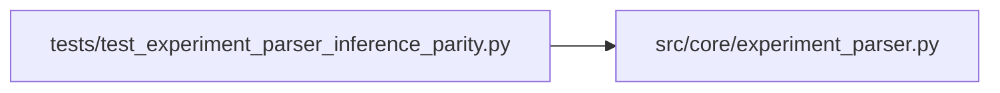

# test_experiment_parser_inference_parity Module

**Path:** `tests/test_experiment_parser_inference_parity.py`

## Description

Tests for experiment_parser _json suffix handling for phase 7 evidence keys.

Verifies that inference_parity_json emitted by prepare.py is parsed into a
dict-valued extra by parse_prepare_output(), so that _has_metric() detects the
key and check_evidence_artifact() can advance inference_parity_replay.

## Imports

| Source | Symbols |
|--------|---------|
| `__future__` | `annotations` |
| `json` | `json` |
| `src.core.experiment_parser` | `parse_prepare_output` |

## Local dependency map

<!-- Auto-generated local dependency summary. Do not edit by hand. -->

### Internal neighbors

| Direction | Module |
|---|---|
| Outbound | [experiment_parser](../modules/experiment_parser.md) |

## Functions

| Function | Signature | Decorators | Description |
|----------|-----------|------------|-------------|
| `_block` | `(extra_lines: str = '') -> str` | — | — |
| `test_inference_parity_json_parsed_as_dict` | `() -> None` | — | — |
| `test_inference_parity_in_to_dict` | `() -> None` | — | — |
| `test_inference_parity_hash_fallback_structure` | `() -> None` | — | — |
| `test_missing_inference_parity_produces_no_extra` | `() -> None` | — | — |
