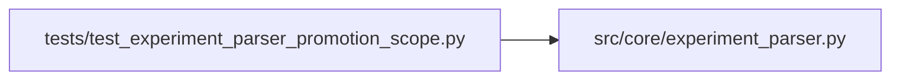

# test_experiment_parser_promotion_scope Module

**Path:** `tests/test_experiment_parser_promotion_scope.py`

## Description

Tests for experiment_parser handling of phase 8 evidence key (promotion_scope).

Verifies that promotion_scope emitted by prepare.py is stored correctly by
parse_prepare_output() so that _has_metric() can detect it and advance
promotion_proposal. No _json suffix needed — key presence is all that matters.

## Imports

| Source | Symbols |
|--------|---------|
| `__future__` | `annotations` |
| `src.core.experiment_parser` | `parse_prepare_output` |

## Local dependency map

<!-- Auto-generated local dependency summary. Do not edit by hand. -->

### Internal neighbors

| Direction | Module |
|---|---|
| Outbound | [experiment_parser](../modules/experiment_parser.md) |

## Functions

| Function | Signature | Decorators | Description |
|----------|-----------|------------|-------------|
| `_block` | `(extra_lines: str = '') -> str` | — | — |
| `test_promotion_scope_stored_in_extra` | `() -> None` | — | — |
| `test_promotion_scope_in_to_dict` | `() -> None` | — | — |
| `test_promotion_scope_absent_when_not_emitted` | `() -> None` | — | — |
