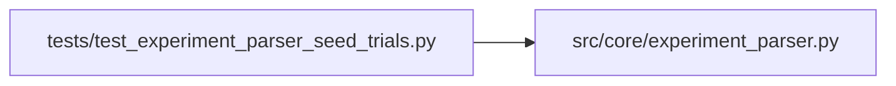

# test_experiment_parser_seed_trials Module

**Path:** `tests/test_experiment_parser_seed_trials.py`

## Description

Tests for experiment_parser _json suffix handling for phase 6 evidence keys.

Verifies that seed_trials_json, n_seed_trials_json, and seeds_passed_gates emitted
by prepare.py are parsed correctly by parse_prepare_output() so that
check_evidence_artifact() can advance multi_seed_robustness.

Critical: n_seed_trials must be stored as int (not float). Plain numeric values
are stored as float by the parser fallback; the _json suffix forces json.loads()
which preserves int type. The validator does isinstance(n_required, int) and
resets to 2 if it gets a float, which would cause a single-seed probe to fail.

## Imports

| Source | Symbols |
|--------|---------|
| `__future__` | `annotations` |
| `json` | `json` |
| `src.core.experiment_parser` | `parse_prepare_output` |

## Local dependency map

<!-- Auto-generated local dependency summary. Do not edit by hand. -->

### Internal neighbors

| Direction | Module |
|---|---|
| Outbound | [experiment_parser](../modules/experiment_parser.md) |

## Functions

| Function | Signature | Decorators | Description |
|----------|-----------|------------|-------------|
| `_block` | `(extra_lines: str = '') -> str` | — | — |
| `test_seed_trials_json_parsed_as_list` | `() -> None` | — | — |
| `test_n_seed_trials_json_stored_as_int` | `() -> None` | — | — |
| `test_seeds_passed_gates_stored` | `() -> None` | — | — |
| `test_all_three_seed_keys_in_to_dict` | `() -> None` | — | — |
| `test_seed_trials_artifact_hash_fallback` | `() -> None` | — | — |
