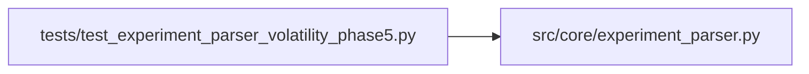

# test_experiment_parser_volatility_phase5 Module

**Path:** `tests/test_experiment_parser_volatility_phase5.py`

## Description

Tests for experiment_parser handling of phase 5 evidence keys emitted by volatility prepare.py.

Volatility phase 5 (calibration_replay_gates): prepare.py builds a proxy
calibration_full_validation from a config-derived artifact_hash (no
calibration_full_validation key exists in volatility results.json).
The selected.artifact_hash is a 16-char hex string from hashlib.sha256.

## Imports

| Source | Symbols |
|--------|---------|
| `__future__` | `annotations` |
| `json` | `json` |
| `src.core.experiment_parser` | `parse_prepare_output` |

## Local dependency map

<!-- Auto-generated local dependency summary. Do not edit by hand. -->

### Internal neighbors

| Direction | Module |
|---|---|
| Outbound | [experiment_parser](../modules/experiment_parser.md) |

## Functions

| Function | Signature | Decorators | Description |
|----------|-----------|------------|-------------|
| `_block` | `(extra_lines: str = '') -> str` | — | — |
| `_cal_payload` | `(artifact_hash: str = 'abcdef1234567890') -> dict` | — | — |
| `_eco_payload` | `() -> dict` | — | — |
| `test_calibration_full_validation_parsed_as_dict` | `() -> None` | — | — |
| `test_calibration_selected_has_artifact_hash` | `() -> None` | — | — |
| `test_economic_replay_parsed_as_dict` | `() -> None` | — | — |
| `test_both_phase5_keys_in_to_dict` | `() -> None` | — | — |
| `test_phase5_absent_when_not_emitted` | `() -> None` | — | — |
