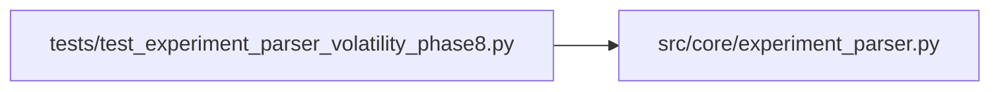

# test_experiment_parser_volatility_phase8 Module

**Path:** `tests/test_experiment_parser_volatility_phase8.py`

## Description

Tests for experiment_parser handling of phases 6-8 evidence keys
emitted by the volatility experiment scripts.

Phases 6 (multi_seed_robustness), 7 (inference_parity_replay), and 8 (promotion_proposal)
use identical evidence key emission patterns in both direction and volatility prepare.py.
These tests verify the parser handles the volatility metric_name (auc vs composite_direction_score).

## Imports

| Source | Symbols |
|--------|---------|
| `__future__` | `annotations` |
| `json` | `json` |
| `src.core.experiment_parser` | `parse_prepare_output` |

## Local dependency map

<!-- Auto-generated local dependency summary. Do not edit by hand. -->

### Internal neighbors

| Direction | Module |
|---|---|
| Outbound | [experiment_parser](../modules/experiment_parser.md) |

## Functions

| Function | Signature | Decorators | Description |
|----------|-----------|------------|-------------|
| `_block` | `(extra_lines: str = '') -> str` | — | — |
| `test_seed_trials_json_parsed_as_list` | `() -> None` | — | — |
| `test_n_seed_trials_json_stored_as_int` | `() -> None` | — | — |
| `test_seeds_passed_gates_stored` | `() -> None` | — | — |
| `test_inference_parity_json_parsed_as_dict` | `() -> None` | — | — |
| `test_inference_parity_hash_fallback` | `() -> None` | — | — |
| `test_promotion_scope_stored_in_extra` | `() -> None` | — | — |
| `test_promotion_scope_in_to_dict` | `() -> None` | — | — |
