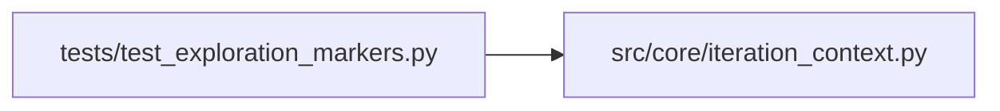

# test_exploration_markers Module

**Path:** `tests/test_exploration_markers.py`

## Description

Gap 1 — server-side derivation of phase-advancement markers from
salient-knob diffs vs the baseline iter's config_snapshot.

After Issue 10A narrowed ``_PHASE_ADVANCEMENT_KEYS`` to deliberate-exploration
markers (``tabular_sweep_variant`` etc.), live evidence (``res_baf6605ce94f``)
showed the agent ignored the prompt instruction to emit those keys, falling
through to the slow >=6 cardinality fallback. ``derive_exploration_markers``
auto-injects the marker from any salient-knob diff vs baseline so the fast
key-path fires whenever the agent actually explores.

## Imports

| Source | Symbols |
|--------|---------|
| `__future__` | `annotations` |
| `src.core.iteration_context` | `derive_exploration_markers` |

## Local dependency map

<!-- Auto-generated local dependency summary. Do not edit by hand. -->

### Internal neighbors

| Direction | Module |
|---|---|
| Outbound | [iteration_context](../modules/iteration_context.md) |

## Functions

| Function | Signature | Decorators | Description |
|----------|-----------|------------|-------------|
| `test_direction_no_diff_returns_empty` | `() -> None` | — | Baseline iter (current == baseline) yields no markers — the phase |
| `test_direction_pct_threshold_diff_emits_tabular_variant` | `() -> None` | — | — |
| `test_direction_multiple_diffs_concatenate` | `() -> None` | — | Two salient knob diffs produce a single variant value combining |
| `test_direction_non_salient_knob_diff_ignored` | `() -> None` | — | A knob NOT in _KNOB_TO_MARKER must not produce a marker. |
| `test_direction_none_current_value_treated_as_no_diff` | `() -> None` | — | When the current config doesn't carry a knob (None), we skip it. |
| `test_direction_feature_lane_toggle_emits_tabular_variant` | `() -> None` | — | Flipping a nested feature_config lane is a deliberate feature-set |
| `test_direction_feature_lane_absent_in_baseline_counts_as_diff` | `() -> None` | — | Baseline omits the lane key entirely (the common case — only funding is |
| `test_direction_feature_config_unchanged_returns_empty` | `() -> None` | — | — |
| `test_direction_meta_model_is_no_longer_salient` | `() -> None` | — | meta_model was pruned from the knob map: serving is Option A (best base |
| `test_volatility_atr_diff_emits_atr_mult_sweep_enabled` | `() -> None` | — | — |
| `test_volatility_threshold_diff_emits_threshold_attempt_id` | `() -> None` | — | — |
| `test_volatility_temporal_diff_emits_temporal_attempt_id` | `() -> None` | — | — |
| `test_volatility_multi_family_diff_emits_three_keys` | `() -> None` | — | An iteration that changes knobs spanning all three volatility |
| `test_missing_baseline_returns_empty` | `() -> None` | — | No baseline config → no comparison possible → empty (the |
| `test_missing_current_returns_empty` | `() -> None` | — | — |
| `test_unknown_model_type_returns_empty` | `() -> None` | — | RL has no entry in _KNOB_TO_MARKER today (no tabular-family phases). |
