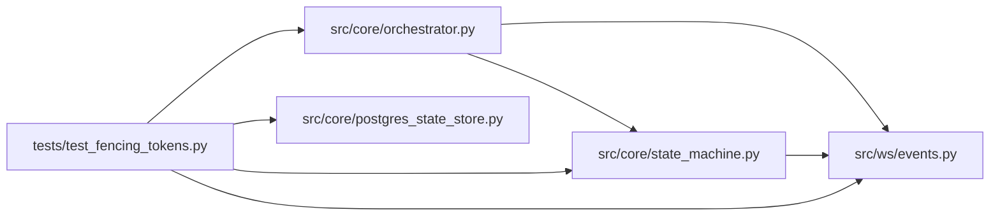

# test_fencing_tokens Module

**Path:** `tests/test_fencing_tokens.py`

## Description

ARC-011 P6-004 — fencing tokens + cross-worker control tests.

Validates the H3 (cross-worker stop/pause propagation) and H4 (stale-write
fencing) fixes against a live Postgres, simulating two workers as two
``PostgresStateStore`` instances sharing the same pool/DB within one process.
The real multi-process harness is P6-007; this is the in-process precursor.

Skipped when ``AUTORESEARCH_DATABASE_URL`` is unset.

## Imports

| Source | Symbols |
|--------|---------|
| `__future__` | `annotations` |
| `asyncpg` | `asyncpg` |
| `os` | `os` |
| `pytest` | `pytest` |
| `src.core.orchestrator` | `AgentOrchestrator`, `AgentOrchestrator`, `AgentOrchestrator`, `AgentOrchestrator`, `AgentOrchestrator` |
| `src.core.postgres_state_store` | `PostgresStateStore` |
| `src.core.state_machine` | `SessionStateMachine`, `SessionStateMachine`, `SessionStateMachine` |
| `src.ws.events` | `EventBroadcaster`, `EventBroadcaster`, `EventBroadcaster` |
| `uuid` | `uuid` |

## Local dependency map

<!-- Auto-generated local dependency summary. Do not edit by hand. -->

### Internal neighbors

| Direction | Module |
|---|---|
| Outbound | [orchestrator](../modules/orchestrator.md) |
| Outbound | [postgres_state_store](../modules/postgres_state_store.md) |
| Outbound | [state_machine](../modules/state_machine.md) |
| Outbound | [events](../modules/events.md) |

### External packages

| Language | Used packages | Undeclared packages |
|---|---:|---:|
| python | 2 | 1 |

## Functions

| Function | Signature | Decorators | Description |
|----------|-----------|------------|-------------|
| `_base_dsn` | `() -> str \| None` | — | — |
| `pg_store` | *(async)* `()` | `@pytest.fixture()` | — |
| `_seed_session` | *(async)* `(store, sid: str) -> None` | — | — |
| `test_cross_worker_stop_observed_by_owner` | *(async)* `(pg_store)` | — | H3: a stop transition on worker B is observed by worker A's poll. |
| `test_cross_worker_stop_false_for_active_session` | *(async)* `(pg_store)` | — | No false positives: an active running session is not 'stopped'. |
| `test_update_session_fencing_stale_epoch_rejected` | *(async)* `(pg_store)` | — | H4: update_session with a stale lock_epoch returns None (0 rows). |
| `test_bump_session_epoch_monotonic` | *(async)* `(pg_store)` | — | bump_session_epoch increments lock_epoch by 1 each call. |
| `test_transition_bumps_epoch` | *(async)* `(pg_store)` | — | A committed transition increments lock_epoch (P6-003/P6-004 wiring). |
| `test_integrated_fence_stale_worker_discards_result` | *(async)* `(pg_store)` | — | Full chain: worker A captures epoch 0; worker B stops the session |
| `test_integrated_fence_fresh_epoch_records_normally` | *(async)* `(pg_store)` | — | The fence only rejects STALE epochs: with no intervening transition, |
| `test_integrated_fence_normal_completion_not_discarded` | *(async)* `(pg_store)` | — | A session whose status reached `completed` (the normal completing → |
