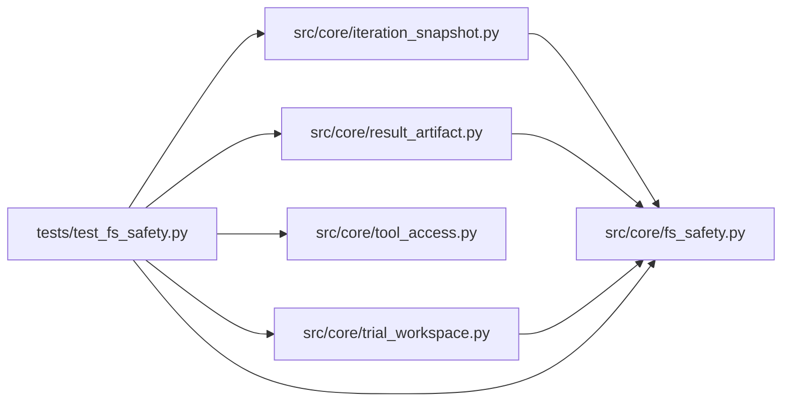

# test_fs_safety Module

**Path:** `tests/test_fs_safety.py`

## Description

Symlink-race and shared-alias resistance for filesystem operations.

Every sensitive write must be immune to check/use races: dangling leaf
links, linked parents, hardlink aliases, and concurrent rename/link
replacement must never create or overwrite data outside the authorized
root. Denied operations must name themselves (``write`` / ``read`` /
``copy``) in the error.

## Imports

| Source | Symbols |
|--------|---------|
| `__future__` | `annotations` |
| `json` | `json` |
| `os` | `os` |
| `pathlib` | `Path` |
| `pytest` | `pytest` |
| `src.core` | `fs_safety` |
| `src.core.fs_safety` | `FilesystemSafetyError` |
| `src.core.iteration_snapshot` | `write_iteration_attempt_snapshot` |
| `src.core.result_artifact` | `enrich_marker_from_result_artifact` |
| `src.core.tool_access` | `build_tool_access_context` |
| `src.core.trial_workspace` | `stage_trial_workspace` |
| `stat` | `stat` |
| `threading` | `threading` |

## Local dependency map

<!-- Auto-generated local dependency summary. Do not edit by hand. -->

### Internal neighbors

| Direction | Module |
|---|---|
| Outbound | [fs_safety](../modules/fs_safety.md) |
| Outbound | [iteration_snapshot](../modules/iteration_snapshot.md) |
| Outbound | [result_artifact](../modules/result_artifact.md) |
| Outbound | [tool_access](../modules/tool_access.md) |
| Outbound | [trial_workspace](../modules/trial_workspace.md) |

### External packages

| Language | Used packages | Undeclared packages |
|---|---:|---:|
| python | 1 | 1 |

## Functions

| Function | Signature | Decorators | Description |
|----------|-----------|------------|-------------|
| `_sentinel` | `(outside: Path) -> Path` | — | — |
| `_assert_untouched` | `(sentinel: Path) -> None` | — | — |
| `test_dangling_leaf_symlink_never_creates_the_outside_target` | `(tmp_path: Path) -> None` | — | — |
| `test_symlink_to_existing_file_is_denied_for_write` | `(tmp_path: Path) -> None` | — | — |
| `test_linked_parent_is_denied_for_write` | `(tmp_path: Path, target_kind: str) -> None` | `@pytest.mark.parametrize('target_kind', ['outside', 'inside'])` | — |
| `test_hardlinked_leaf_write_is_denied` | `(tmp_path: Path) -> None` | — | — |
| `test_non_regular_leaf_write_is_denied` | `(tmp_path: Path) -> None` | — | — |
| `test_unsafe_relative_paths_are_rejected` | `(tmp_path: Path, bad: str) -> None` | `@pytest.mark.parametrize('bad', ['', '/etc/passwd', '../escape.txt', 'a/../../b.txt'])` | — |
| `test_nested_parent_creation_without_following_links` | `(tmp_path: Path) -> None` | — | — |
| `test_replace_updates_regular_leaf_without_temp_leftovers` | `(tmp_path: Path) -> None` | — | — |
| `test_leaf_swapped_to_dangling_link_after_authorization_is_denied` | `(tmp_path: Path) -> None` | — | — |
| `test_parent_swapped_to_link_after_authorization_is_denied` | `(tmp_path: Path) -> None` | — | — |
| `test_concurrent_rename_and_link_replacement_never_escapes` | `(tmp_path: Path) -> None` | — | — |
| `test_import_read_requires_regular_single_link_file` | `(tmp_path: Path) -> None` | — | — |
| `test_stage_trial_workspace_skips_links_and_hardlinks` | `(tmp_path: Path) -> None` | — | — |
| `_result_marker` | `(name: str = 'results.json') -> dict` | — | — |
| `test_result_collection_rejects_linked_sources` | `(tmp_path: Path) -> None` | — | — |
| `test_result_collection_target_link_is_not_followed` | `(tmp_path: Path) -> None` | — | — |
| `test_result_collection_still_copies_regular_results` | `(tmp_path: Path) -> None` | — | — |
| `test_attempt_snapshot_write_refuses_planted_target_link` | `(tmp_path: Path) -> None` | — | — |
| `test_attempt_snapshot_write_still_works` | `(tmp_path: Path) -> None` | — | — |
