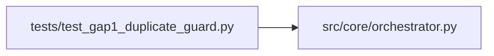

# test_gap1_duplicate_guard Module

**Path:** `tests/test_gap1_duplicate_guard.py`

## Description

Gap 1 regression — server-side variant-marker injection must skip
rejected-duplicate iterations (and iters with no training_time_s).

Live evidence (``res_99469dfc1088`` iter 2, 2026-05-20 21:56 UTC):

- The agent prepared a config matching `direction_pct_threshold=0.05`,
  identical to a config trained in the prior session ``res_baf6605ce94f``.
- The orchestrator's canonical-config dedup rejected the attempt BEFORE
  prepare.py ran. iter 2 was persisted with ``status:rejected_duplicate``,
  ``decision:discard``, ``training_time_s:None``, ``duplicate_reason:"…"``.
- Gap 1's ``_record_iteration`` injection block fired anyway because the
  current config differed from baseline in a salient knob. Result:
  ``metrics_json.tabular_sweep_variant = "direction_pct_threshold=0.05"``.
- The phase plan saw the injected marker and completed ``tabular_sweeps``
  after zero genuine in-phase training — exactly the Issue 10A
  false-advancement bug, via a new path.

The fix: skip injection when ``marker.get("duplicate_reason")`` is set
or ``marker.get("training_time_s") is None`` (no training executed).

## Imports

| Source | Symbols |
|--------|---------|
| `__future__` | `annotations` |
| `anthropic` | `anthropic` |
| `json` | `json` |
| `pytest` | `pytest` |
| `src.core.orchestrator` | `AgentOrchestrator` |
| `sys` | `sys` |
| `types` | `types` |
| `typing` | `Any`, `Dict` |

## Local dependency map

<!-- Auto-generated local dependency summary. Do not edit by hand. -->

### Internal neighbors

| Direction | Module |
|---|---|
| Outbound | [orchestrator](../modules/orchestrator.md) |

### External packages

| Language | Used packages | Undeclared packages |
|---|---:|---:|
| python | 2 | 2 |

## Functions

| Function | Signature | Decorators | Description |
|----------|-----------|------------|-------------|
| `_duplicate_marker` | `() -> Dict[str, Any]` | — | Iter 2 shape from ``res_99469dfc1088`` — rejected as a duplicate |
| `_genuine_marker` | `() -> Dict[str, Any]` | — | Same config but with training_time_s present and no duplicate_reason |
| `test_rejected_duplicate_marker_does_not_get_variant_injected` | *(async)* `(replay_iterations) -> None` | `@pytest.mark.asyncio` | The live regression from ``res_99469dfc1088`` iter 2. |
| `test_no_training_time_marker_does_not_get_variant_injected` | *(async)* `(replay_iterations) -> None` | `@pytest.mark.asyncio` | A marker with ``training_time_s: None`` (no training ran) and no |
| `test_genuine_training_marker_receives_variant` | *(async)* `(replay_iterations) -> None` | `@pytest.mark.asyncio` | Positive control: a normal training iter (training_time_s set, no |
