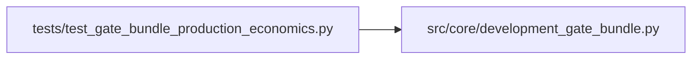

# test_gate_bundle_production_economics Module

**Path:** `tests/test_gate_bundle_production_economics.py`

## Description

MQ-B5 — production-scope unconditional post-cost economic gate.

Pins (development_gate_bundle.evaluate_development_gate_bundle):
1. PRODUCTION scope: a worsening post-cost replay BLOCKS even when the bundle
   YAML lacks `worsening_vs_baseline_blocks_promotion` AND the iteration
   carries a matching waiver (unconditional + unwaivable).
2. DEVELOPMENT scope: legacy behavior preserved — the check runs only when the
   YAML flag is set, and a waiver still bypasses it.
3. Both the direction path and the RL path enforce the production rule.

## Imports

| Source | Symbols |
|--------|---------|
| `__future__` | `annotations` |
| `anthropic` | `anthropic` |
| `json` | `json` |
| `os` | `os` |
| `src.core.development_gate_bundle` | `evaluate_development_gate_bundle` |
| `sys` | `sys` |
| `types` | `types`, `ModuleType` |
| `typing` | `cast` |

## Local dependency map

<!-- Auto-generated local dependency summary. Do not edit by hand. -->

### Internal neighbors

| Direction | Module |
|---|---|
| Outbound | [development_gate_bundle](../modules/development_gate_bundle.md) |

### External packages

| Language | Used packages | Undeclared packages |
|---|---:|---:|
| python | 1 | 1 |

## Functions

| Function | Signature | Decorators | Description |
|----------|-----------|------------|-------------|
| `_rl_iteration` | `(*, waive: bool = False) -> dict` | — | — |
| `_bundle` | `(scope: str, *, with_flag: bool) -> dict` | — | — |
| `_check` | `(result: dict, name: str) -> dict \| None` | — | — |
| `test_production_scope_blocks_worsening_without_yaml_flag` | `() -> None` | — | — |
| `test_production_scope_ignores_waiver` | `() -> None` | — | — |
| `test_development_scope_without_flag_skips_check` | `() -> None` | — | — |
| `test_development_scope_waiver_still_works` | `() -> None` | — | — |
