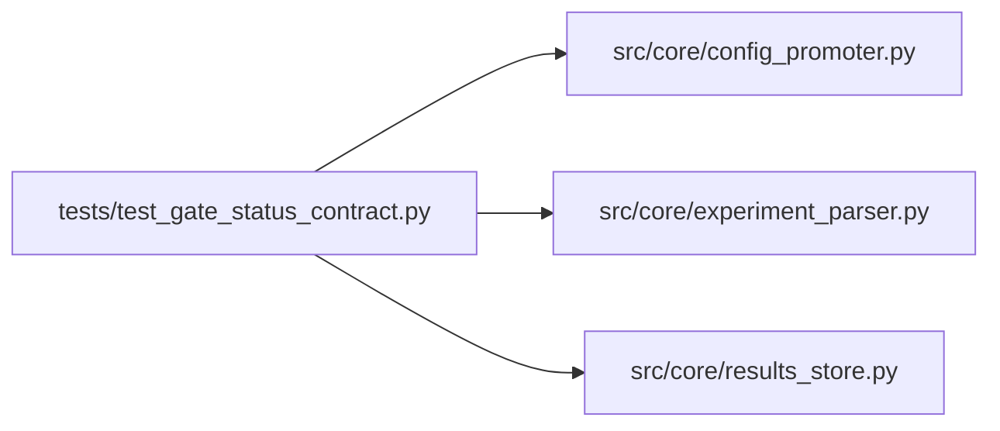

# test_gate_status_contract Module

**Path:** `tests/test_gate_status_contract.py`

## Description

_Auto-generated from `tests/test_gate_status_contract.py`._

## Imports

| Source | Symbols |
|--------|---------|
| `__future__` | `annotations` |
| `json` | `json` |
| `pathlib` | `Path` |
| `pytest` | `pytest` |
| `src.core` | `config_promoter` |
| `src.core.config_promoter` | `ConfigPromoter` |
| `src.core.experiment_parser` | `parse_iteration_marker`, `parse_prepare_output` |
| `src.core.results_store` | `ResultsStore` |
| `typing` | `Any`, `Dict` |

## Local dependency map

<!-- Auto-generated local dependency summary. Do not edit by hand. -->

### Internal neighbors

| Direction | Module |
|---|---|
| Outbound | [config_promoter](../modules/config_promoter.md) |
| Outbound | [experiment_parser](../modules/experiment_parser.md) |
| Outbound | [results_store](../modules/results_store.md) |

### External packages

| Language | Used packages | Undeclared packages |
|---|---:|---:|
| python | 1 | 1 |

## Classes

| Class | Line | Bases | Description |
|-------|------|-------|-------------|
| [FakePromotionStore](../entities/test_gate_status_contract_FakePromotionStore.md) | 15 | — | — |

## Functions

| Function | Signature | Decorators | Description |
|----------|-----------|------------|-------------|
| `_prepare_block` | `(*, training: str \| None, legacy: str \| None) -> str` | — | — |
| `test_parse_prepare_output_accepts_training_gates_passed` | `() -> None` | — | — |
| `test_parse_prepare_output_preserves_legacy_all_gates_passed` | `() -> None` | — | — |
| `test_parse_prepare_output_prefers_training_gate_alias` | `(caplog: pytest.LogCaptureFixture) -> None` | — | — |
| `test_iteration_marker_normalizes_gate_aliases` | `() -> None` | — | — |
| `test_results_store_normalizes_training_gate_aliases` | *(async)* `(tmp_path: Path) -> None` | `@pytest.mark.asyncio` | — |
| `test_preview_splits_training_bundle_consistency_statuses` | *(async)* `(tmp_path: Path, monkeypatch: pytest.MonkeyPatch) -> None` | `@pytest.mark.asyncio` | — |
