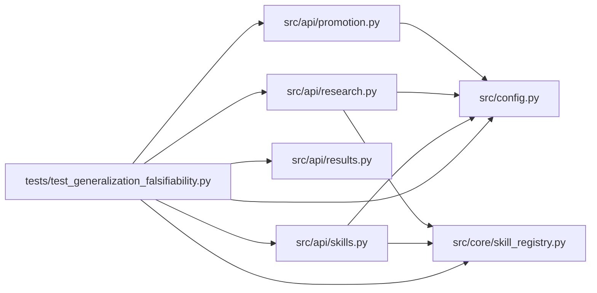

# test_generalization_falsifiability Module

**Path:** `tests/test_generalization_falsifiability.py`

## Description

Automated §7.14 generalization falsifiability suite (ARC-011 P3-030, §8.2/§8.3).

This is the **Phase 3 exit gate**. It encodes ARC-011 §7.14 / §8.2 / §8.3 as
executable assertions. If any of these fail, the generalization is falsified —
the orchestrator or UI is still domain-coupled and Phase 3 is not done.

Assertions (from §8.2 / §8.3):

* **GEN-003** — ``GET /skills`` lists ``ml-direction``, ``ml-volatility``, ``ml-rl``.
* **Uniformity** — every skill descriptor carries the fields the UI needs
  (``form_fields``, ``metric_schema.chart_series``, ``metric_schema.iteration_table_columns``,
  ``promotion_target.primary.kind``) so the *same* UI renders any skill.
* **Drop-a-directory** — a new skill ships under ``skills/<id>/`` with no
  orchestrator or UI code changes; it appears in ``GET /skills`` after reload.
* **Domain-coupling grep guard** — ``orchestrator.py`` has zero hits for the
  Phase-3 deny-list patterns (§1.7).
* **GEN-009** — ML and non-ML sessions have identical row shape (by construction:
  the dual-shape helpers populate the same fields for every ``model_type``).

## Imports

| Source | Symbols |
|--------|---------|
| `__future__` | `annotations` |
| `fastapi` | `FastAPI` |
| `fastapi.testclient` | `TestClient` |
| `os` | `os` |
| `pathlib` | `Path` |
| `pytest` | `pytest` |
| `re` | `re` |
| `src.api` | `skills`, `promotion` |
| `src.api.promotion` | `_inject_target_kind`, `_inject_target_kind`, `_inject_target_kind`, `_registry` |
| `src.api.research` | `_dual_shape_session` |
| `src.api.results` | `_enrich_iteration` |
| `src.api.skills` | `router` |
| `src.config` | `settings` |
| `src.core.skill_registry` | `DEFAULT_SKILLS_ROOT`, `SkillRegistry`, `SkillRegistry` |
| `textwrap` | `textwrap` |

## Local dependency map

<!-- Auto-generated local dependency summary. Do not edit by hand. -->

### Internal neighbors

| Direction | Module |
|---|---|
| Outbound | [promotion](../modules/promotion.md) |
| Outbound | [research](../modules/research.md) |
| Outbound | [results](../modules/results.md) |
| Outbound | [src_api_skills](../modules/src_api_skills.md) |
| Outbound | [config](../modules/config.md) |
| Outbound | [skill_registry](../modules/skill_registry.md) |

### External packages

| Language | Used packages | Undeclared packages |
|---|---:|---:|
| python | 2 | 2 |

## Functions

| Function | Signature | Decorators | Description |
|----------|-----------|------------|-------------|
| `create_test_app` | `() -> FastAPI` | — | — |
| `configure` | `(monkeypatch: pytest.MonkeyPatch)` | `@pytest.fixture(autouse=True)` | — |
| `client` | `() -> TestClient` | `@pytest.fixture` | — |
| `auth_headers` | `() -> dict[str, str]` | — | — |
| `test_gen003_skills_lists_installed_skills` | `(client: TestClient)` | — | GEN-003: GET /skills lists every installed skill package. |
| `test_every_skill_has_ui_render_fields` | `(client: TestClient, skill_id: str)` | `@pytest.mark.parametrize('skill_id', sorted(_EXPECTED_SKILL_IDS))` | §8.2: the same UI renders every skill's form/chart/table from |
| `test_drop_a_directory_skill_appears_after_reload` | `(tmp_path: Path)` | — | §8.2 / §7.14: a new skill ships as a directory under ``skills/`` with |
| `test_orchestrator_domain_coupling_grep_guard` | `()` | — | §1.7 / §7.14: ``orchestrator.py`` must have zero hits for the Phase-3 |
| `test_gen009_dual_shape_uniformity_across_model_types` | `()` | — | GEN-009 / §8.2: an ML session and a (future) non-ML session are |
| `test_gen010_dual_shape_iteration_has_canonical_fields` | `()` | — | GEN-010 / P3-015/016: iteration responses carry canonical skill fields |
| `test_p3_017_inject_target_kind_defaults_to_file_path` | `()` | — | P3-017: ``_inject_target_kind`` defaults to ``file_path`` when the |
| `test_p3_017_inject_target_kind_does_not_overwrite` | `()` | — | P3-017: ``_inject_target_kind`` is additive — it never overwrites an |
| `test_p3_017_inject_target_kind_from_registry` | `()` | — | P3-017: when a skill registry is wired, ``target_kind`` is derived from |
